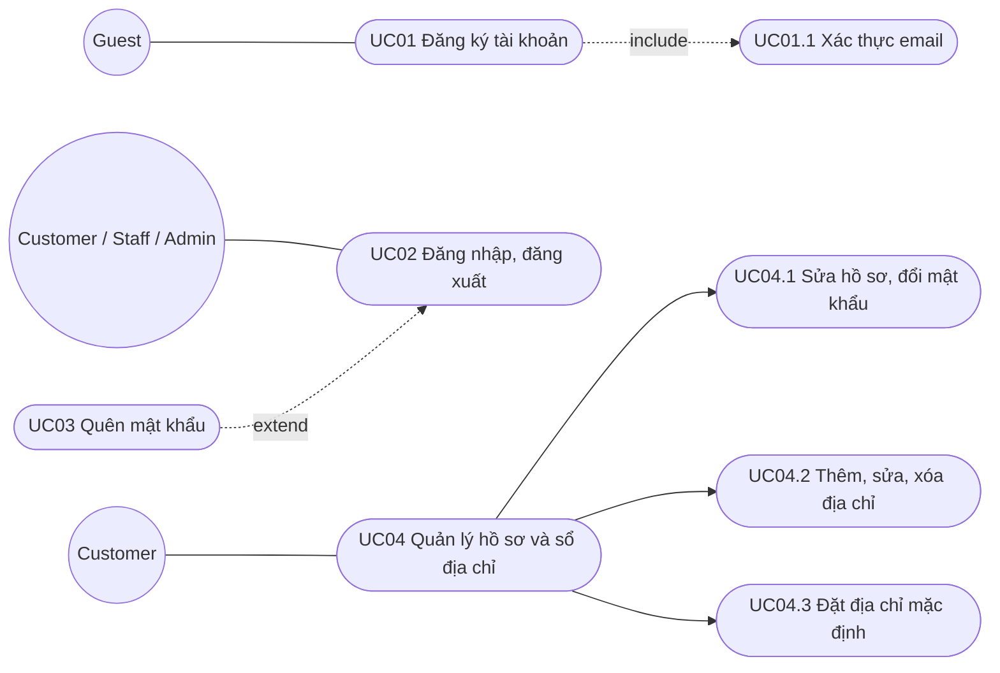

Nguồn: 01-UC.md > Mirra — B1: Phân rã và đặc tả use case > 2. Phân rã use case > 2.1 Quản lý tài khoản
### 2.1 Quản lý tài khoản

| UC | Quan hệ | Điều kiện, ghi chú | Giai đoạn |
| --- | --- | --- | --- |
| UC01.1 Xác thực email | «include» UC01 | Link hết hạn sau 24 giờ, gửi lại được | MVP |
| UC03 Quên mật khẩu | «extend» UC02 | Khi người dùng bấm "Quên mật khẩu" | Mở rộng |
| UC04.1–UC04.3 | UC con của UC04 | Đặc tả gộp ở mục 4 | MVP |

