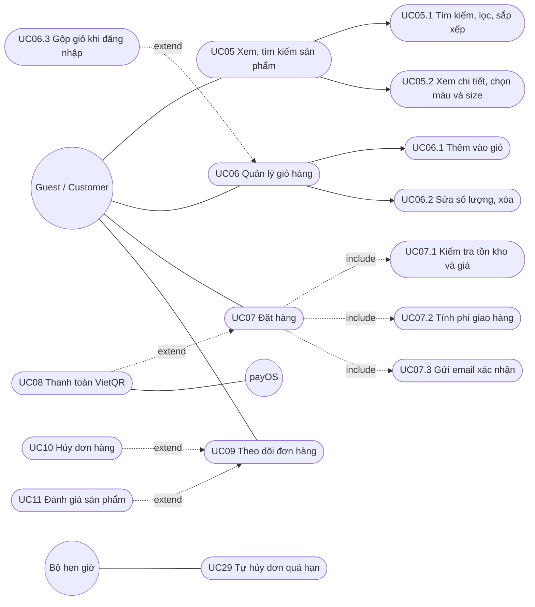

Nguồn: 01-UC.md > Mirra — B1: Phân rã và đặc tả use case > 2. Phân rã use case > 2.2 Mua hàng và thanh toán
### 2.2 Mua hàng và thanh toán

| UC | Quan hệ | Điều kiện, ghi chú | Giai đoạn |
| --- | --- | --- | --- |
| UC05.1, UC05.2 | UC con của UC05 |  | MVP |
| UC06.1, UC06.2 | UC con của UC06 | Guest: giỏ ở trình duyệt; Customer: giỏ trên server | MVP |
| UC06.3 Gộp giỏ | «extend» UC06 | Khi Guest có giỏ rồi đăng nhập | MVP |
| UC07.1–UC07.3 | «include» UC07 |  | MVP |
| UC08 Thanh toán VietQR | «extend» UC07 | Khi khách chọn VietQR | MVP |
| UC09 Theo dõi đơn |  | Customer xem lịch sử đơn; Guest mở link có token | MVP |
| UC10 Hủy đơn | «extend» UC09 | Đơn còn Chờ thanh toán hoặc Chờ xác nhận | MVP |
| UC11 Đánh giá | «extend» UC09 | Đơn đã Hoàn thành, chỉ Customer | Mở rộng |
| UC29 Tự hủy đơn | Bộ hẹn giờ | Đơn VietQR quá 15 phút chưa trả | MVP |

