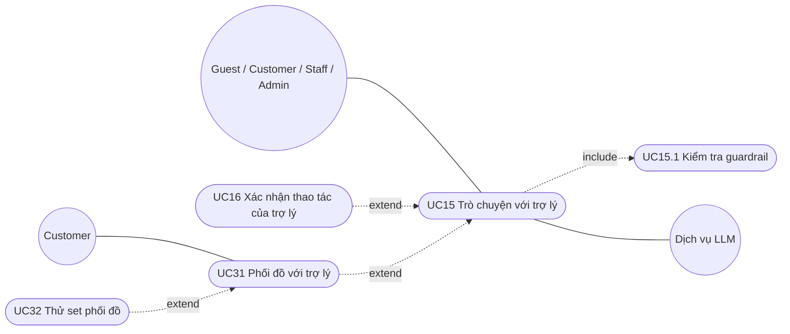

Nguồn: 01-UC.md > Mirra — B1: Phân rã và đặc tả use case > 2. Phân rã use case > 2.3 Trò chuyện với trợ lý AI
### 2.3 Trò chuyện với trợ lý AI

| UC | Quan hệ | Điều kiện, ghi chú | Giai đoạn |
| --- | --- | --- | --- |
| UC15.1 Kiểm tra guardrail | «include» UC15 | Mọi tin nhắn đều qua | MVP |
| UC16 Xác nhận thao tác | «extend» UC15 | Khi tool cần ghi dữ liệu | MVP |
| UC31 Phối đồ với trợ lý | «extend» UC15 | Customer yêu cầu phối đồ; dùng tool `suggest_outfit` | MVP |
| UC32 Thử set phối đồ | «extend» UC31 | Customer bấm "Thử cả set" trên thẻ set; chi tiết ở mục 2.4 | MVP |

Bộ tool của Customer sau thay đổi: `search_products`, `faq_policy`, `recommend_size`, `start_tryon`, `get_my_orders`, `suggest_outfit` (6 tool).

