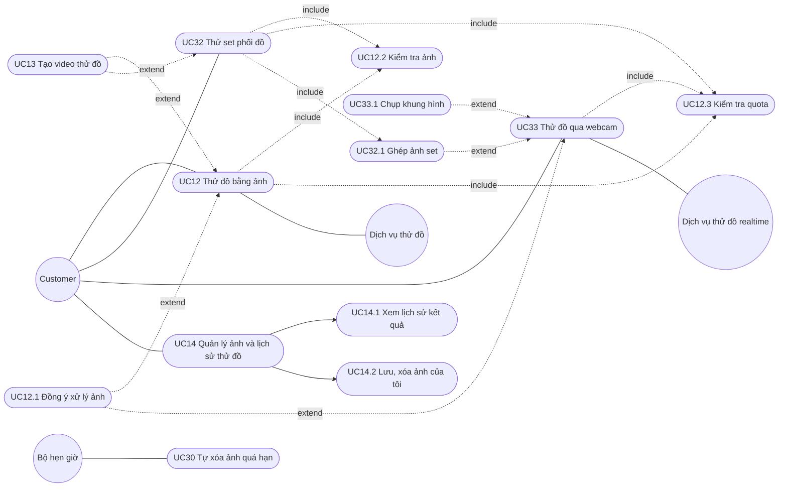

Nguồn: 01-UC.md > Mirra — B1: Phân rã và đặc tả use case > 2. Phân rã use case > 2.4 Thử đồ ảo
### 2.4 Thử đồ ảo

| UC | Quan hệ | Điều kiện, ghi chú | Giai đoạn |
| --- | --- | --- | --- |
| UC12.1 Đồng ý xử lý ảnh | «extend» UC12 | Lần đầu thử đồ, hoặc khi điều khoản đổi phiên bản; cũng áp dụng cho UC32 | MVP |
| UC12.2 Kiểm tra ảnh | «include» UC12, UC32 | Đúng 1 người, thấy toàn thân, định dạng và dung lượng hợp lệ, ảnh k phải ảnh nhạy cảm | MVP |
| UC12.3 Kiểm tra quota | «include» UC12, UC32 | Kết quả lấy từ cache không trừ lượt | MVP |
| UC32.1 Ghép ảnh set | «include» UC32 | Chuẩn bị ảnh tham chiếu của set: 2 món chụp chung một ảnh người mẫu (set cùng chất) thì dùng thẳng ảnh đó; ngược lại ghép ảnh tham chiếu của món trên và món dưới thành một ảnh trang phục | MVP |
| UC13 Tạo video | «extend» UC12, UC32 | Khi khách bấm "Tạo video" trên kết quả | Mở rộng |
| UC14.1, UC14.2 | UC con của UC14 | Từ kết quả có nút "Thêm vào giỏ" (gọi UC06.1) | MVP |
| UC30 Tự xóa ảnh | Bộ hẹn giờ | Ảnh người dùng và kết quả quá 30 ngày | MVP |

| UC bổ sung | Quan hệ | Điều kiện, ghi chú | Giai đoạn |
| --- | --- | --- | --- |
| UC33 Thử đồ qua webcam | «include» UC12.3 (quota webcam riêng) | Mở từ nút "Thử qua webcam" ở trang sản phẩm, hoặc từ thẻ sản phẩm/thẻ set trong khung chat | MVP |
| UC12.1 Đồng ý | «extend» UC33 | Lần đầu dùng webcam: đồng ý xử lý hình ảnh và cấp quyền camera | MVP |
| UC32.1 Ghép ảnh set | «extend» UC33 | Khi mở webcam từ thẻ set phối đồ | MVP |
| UC33.1 Chụp khung hình | «extend» UC33 | Khách bấm "Chụp"; ảnh lưu vào lịch sử theo BR16 | MVP |

