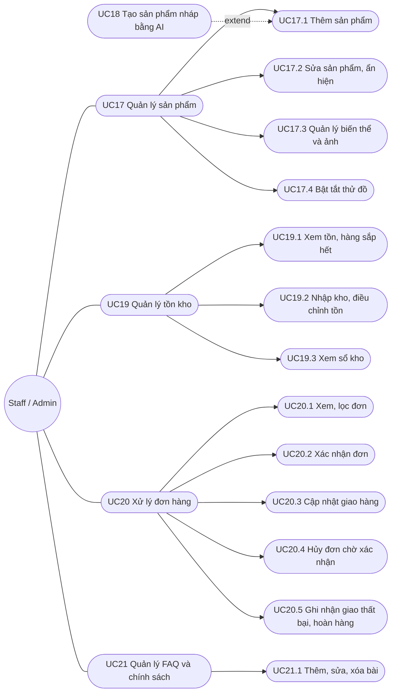

Nguồn: 01-UC.md > Mirra — B1: Phân rã và đặc tả use case > 2. Phân rã use case > 2.5 Vận hành cửa hàng
### 2.5 Vận hành cửa hàng

| UC | Quan hệ | Điều kiện, ghi chú | Giai đoạn |
| --- | --- | --- | --- |
| UC17.1–UC17.4 | UC con của UC17 | Staff không sửa giá; sản phẩm mới ở trạng thái Nháp | MVP |
| UC18 Tạo nháp bằng AI | «extend» UC17.1 | Khi Staff tải ảnh và bấm "Tạo nháp bằng AI" | Mở rộng |
| UC19.1–UC19.3 | UC con của UC19 | Mọi điều chỉnh bắt buộc ghi lý do | MVP |
| UC20.1–UC20.5 | UC con của UC20 | UC20.2 với đơn COD của Guest: gọi xác nhận trước (BR13) | MVP |
| UC21.1 | UC con của UC21 | Lưu xong phát sự kiện để ai-service cập nhật chỉ mục | MVP |

