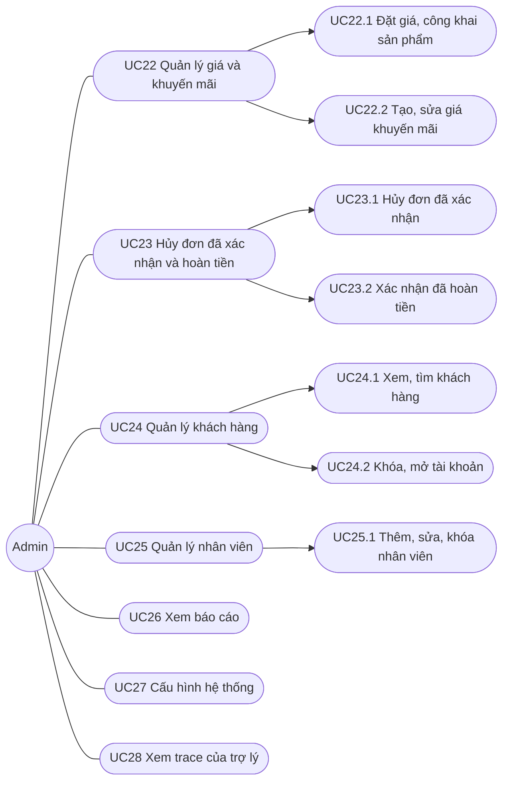

Nguồn: 01-UC.md > Mirra — B1: Phân rã và đặc tả use case > 2. Phân rã use case > 2.6 Quản trị hệ thống
### 2.6 Quản trị hệ thống

| UC | Quan hệ | Điều kiện, ghi chú | Giai đoạn |
| --- | --- | --- | --- |
| UC22.1, UC22.2 | UC con của UC22 |  | MVP |
| UC23.1, UC23.2 | UC con của UC23 | UC23.2 khi thanh toán ở trạng thái Cần hoàn tiền | MVP |
| UC24.1 | UC con của UC24 | Staff cũng xem được | MVP |
| UC24.2 | UC con của UC24 | Chỉ Admin | MVP |
| UC25.1 | UC con của UC25 |  | MVP |
| UC26 Xem báo cáo |  | Doanh thu, top sản phẩm, tỉ lệ thử đồ rồi mua, chi phí AI | Mở rộng |
| UC27 Cấu hình |  | Quota thử đồ, hạn mức chat, bảng phí vùng và ngưỡng miễn phí ship, bảng size | MVP |
| UC28 Xem trace |  | Mở trace của một hội thoại | Mở rộng |

