Nguồn: 02-BCE-AND-SEQUENCE.md > Mirra — B2: Phân tích BCE và sequence > 8. Sơ đồ lớp phân tích gộp > 8.1 Lớp thực thể gộp
### 8.1 Lớp thực thể gộp

Gộp toàn bộ lớp entity từ các mục 2–7, kèm thuộc tính chính và bội số quan hệ. Thuộc tính ở mức phân tích, chưa có kiểu dữ liệu và khóa; phần đó thuộc B4 (ERD, từ điển dữ liệu). Lớp boundary và control không vẽ lại ở đây để sơ đồ đọc được; quan hệ control → entity nằm ở bảng 8.2.

```mermaid
classDiagram
  direction LR
  class User { <<entity>>
    +email
    +passwordHash
    +fullName
    +phone
    +role
    +status
    +emailVerifiedAt
    +failedLoginCount
    +lockedUntil }
  class AuthToken { <<entity>>
    +kind
    +tokenHash
    +expiresAt
    +revokedAt }
  class Address { <<entity>>
    +receiverName
    +phone
    +detail
    +isDefault }
  class AdminUnit { <<entity>>
    +wardCode
    +wardName
    +provinceName
    +lat
    +lng }
  class Category { <<entity>>
    +name
    +slug }
  class SizeChart { <<entity>>
    +name
    +rows }
  class Product { <<entity>>
    +name
    +slug
    +description
    +material
    +price
    +status
    +tryOnEnabled
    +aiGenerated }
  class ProductVariant { <<entity>>
    +sku
    +color
    +size
    +weightGram
    +stock
    +reserved }
  class ProductImage { <<entity>>
    +color
    +kind
    +url
    +position }
  class Promotion { <<entity>>
    +salePrice
    +startAt
    +endAt }
  class Cart { <<entity>>
    +guestKey
    +updatedAt }
  class CartItem { <<entity>>
    +quantity }
  class Order { <<entity>>
    +code
    +guestEmail
    +guestToken
    +addressSnapshot
    +subtotal
    +shippingFee
    +total
    +status
    +trackingNo }
  class OrderItem { <<entity>>
    +productName
    +color
    +size
    +unitPrice
    +quantity }
  class OrderStatusHistory { <<entity>>
    +fromStatus
    +toStatus
    +actor
    +note
    +at }
  class Payment { <<entity>>
    +method
    +status
    +amount
    +gatewayRef
    +txnId
    +refundTxnRef }
  class InventoryLedgerEntry { <<entity>>
    +delta
    +reason
    +actor
    +balanceAfter
    +at }
  class Review { <<entity>>
    +rating
    +content
    +hidden }
  class Faq { <<entity>>
    +question
    +answer
    +kind
    +active }
  class Setting { <<entity>>
    +key
    +value }
  class SettingHistory { <<entity>>
    +oldValue
    +newValue
    +actor
    +at }
  class PhotoConsent { <<entity>>
    +termsVersion
    +acceptedAt }
  class UserPhoto { <<entity>>
    +url
    +hash
    +expiresAt
    +deletedAt }
  class TryOnJob { <<entity>>
    +kind
    +status
    +resultUrl
    +error
    +createdAt }
  class WebcamSession { <<entity>>
    +maxSeconds
    +usedSeconds
    +status
    +startedAt
    +endedAt }
  class WebcamBudget { <<entity>>
    +period
    +capSeconds
    +reservedSeconds
    +usedSeconds }
  class Conversation { <<entity>>
    +guestSessionId
    +actorRole
    +traceId
    +messageCount }
  class ChatMessage { <<entity>>
    +role
    +content
    +toolCalls
    +createdAt }
  class PendingAction { <<entity>>
    +toolName
    +args
    +status
    +expiresAt }
  class OutfitSuggestion { <<entity>>
    +sets
    +createdAt }
  class SearchDocument { <<entity>>
    +sourceType
    +sourceId
    +text
    +embedding
    +visible }
  class AICostRecord { <<entity>>
    +feature
    +provider
    +units
    +costUsd
    +at }

  User "1" --> "0..*" AuthToken
  User "1" *-- "0..5" Address
  Address "0..*" --> "1" AdminUnit
  Category "1" --> "0..*" Product
  SizeChart "0..1" --> "0..*" Product
  Product "1" *-- "1..*" ProductVariant
  Product "1" *-- "0..*" ProductImage
  Product "1" --> "0..*" Promotion
  User "0..1" --> "0..1" Cart
  Cart "1" *-- "0..*" CartItem
  CartItem "0..*" --> "1" ProductVariant
  User "0..1" --> "0..*" Order
  Order "1" *-- "1..*" OrderItem
  OrderItem "0..*" --> "1" ProductVariant
  Order "1" *-- "1..*" OrderStatusHistory
  Order "1" -- "1" Payment
  ProductVariant "1" --> "0..*" InventoryLedgerEntry
  Order "0..1" --> "0..*" InventoryLedgerEntry
  OrderItem "1" --> "0..1" Review
  User "1" --> "0..*" Review
  Setting "1" --> "0..*" SettingHistory
  User "1" --> "0..*" PhotoConsent
  User "1" *-- "0..3" UserPhoto
  User "1" --> "0..*" TryOnJob
  UserPhoto "0..1" --> "0..*" TryOnJob
  TryOnJob "0..*" --> "1..2" ProductVariant
  TryOnJob "0..1" --> "0..1" TryOnJob : video from image
  User "1" --> "0..*" WebcamSession
  WebcamSession "0..*" --> "1" WebcamBudget
  WebcamSession "1" --> "0..*" TryOnJob : snapshots
  User "0..1" --> "0..*" Conversation
  Conversation "1" *-- "0..*" ChatMessage
  Conversation "1" --> "0..*" PendingAction
  Conversation "1" --> "0..*" OutfitSuggestion
  OutfitSuggestion "0..*" --> "1..*" ProductVariant
  OutfitSuggestion "0..1" --> "0..*" TryOnJob : set try-on
  Product "1" --> "0..1" SearchDocument
  Faq "1" --> "0..1" SearchDocument
  AICostRecord "0..*" --> "0..1" Conversation
  AICostRecord "0..*" --> "0..1" TryOnJob
  AICostRecord "0..*" --> "0..1" WebcamSession
```

Ghi chú về giá trị liệt kê dùng trong các sequence:

| Thuộc tính | Giá trị |
| --- | --- |
| User.role | GUEST (không lưu), CUSTOMER, STAFF, ADMIN |
| User.status | ACTIVE, LOCKED, INVITED |
| AuthToken.kind | REFRESH, VERIFY\_EMAIL, RESET\_PASSWORD, SET\_PASSWORD |
| Product.status | HIDDEN, PUBLISHED |
| ProductImage.kind | MODEL, FLAT\_LAY |
| Order.status (8) | AWAITING\_PAYMENT, AWAITING\_CONFIRMATION, CONFIRMED, SHIPPING, DELIVERED, CANCELLED, DELIVERY\_FAILED, RETURNED |
| Payment.method | COD, VIETQR |
| Payment.status (4) | UNPAID, PAID, REFUND\_REQUIRED, REFUNDED |
| TryOnJob.kind | IMAGE, VIDEO, SET\_IMAGE, WEBCAM\_SNAPSHOT |
| TryOnJob.status | PENDING, PROCESSING, COMPLETED, FAILED |
| WebcamSession.status | OPEN, CLOSED, EXPIRED |
| PendingAction.status | PENDING, CONFIRMED, REJECTED, EXPIRED |
| SearchDocument.sourceType | PRODUCT, FAQ |
| Faq.kind | FAQ, POLICY |

