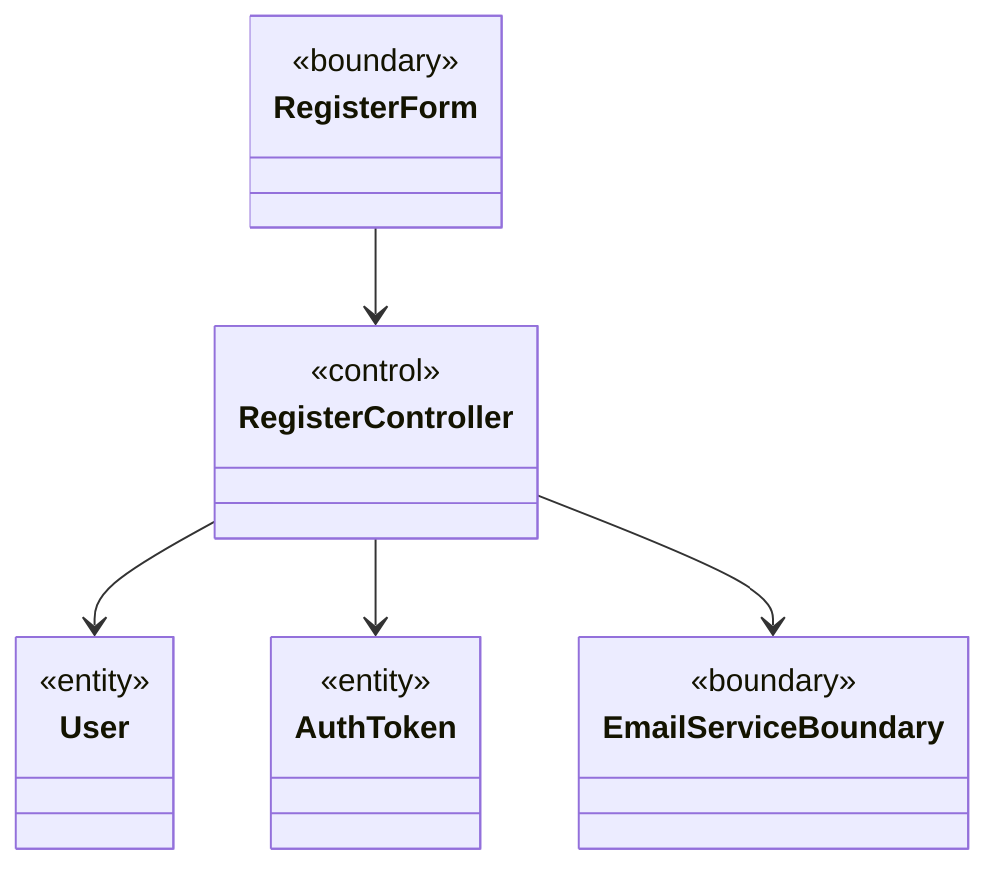
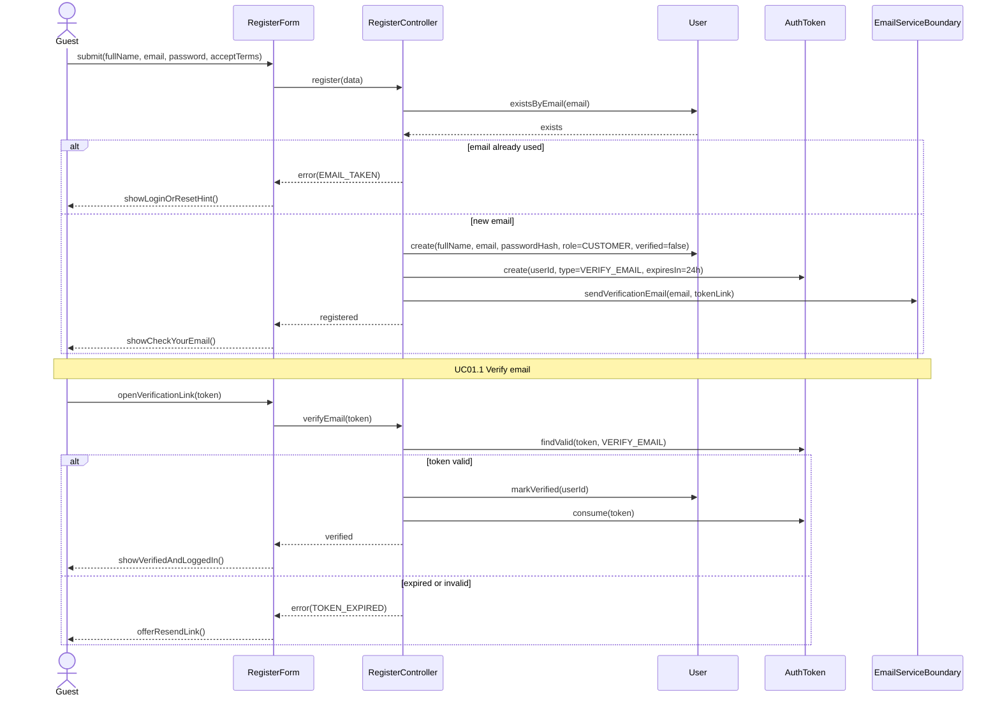

Nguồn: 02-BCE-AND-SEQUENCE.md > Mirra — B2: Phân tích BCE và sequence > 2. Nhóm Tài khoản > UC01 – Register account (gồm UC01.1 Verify email)
### UC01 – Register account (gồm UC01.1 Verify email)

