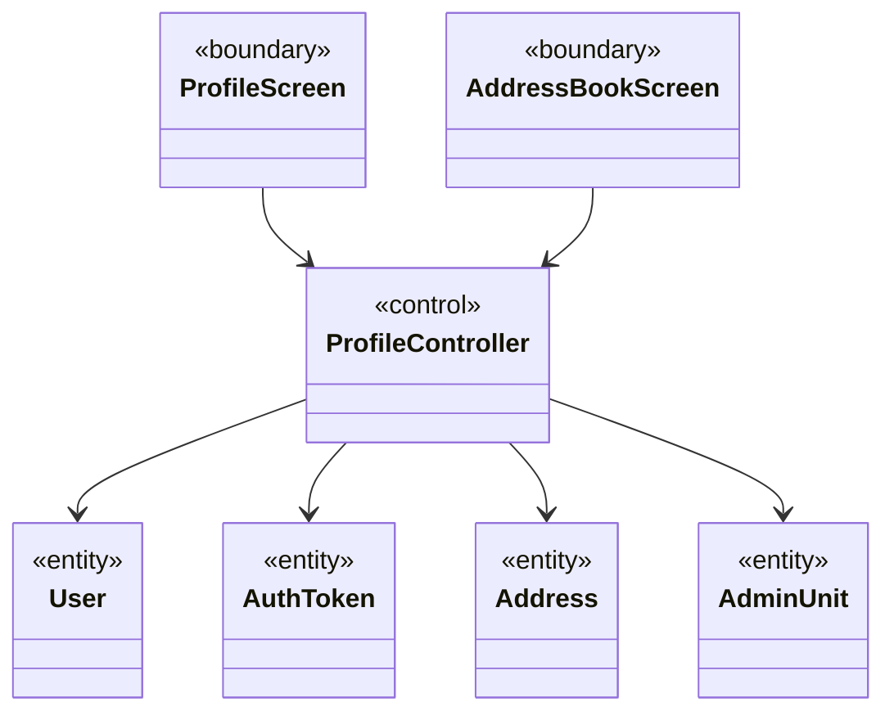
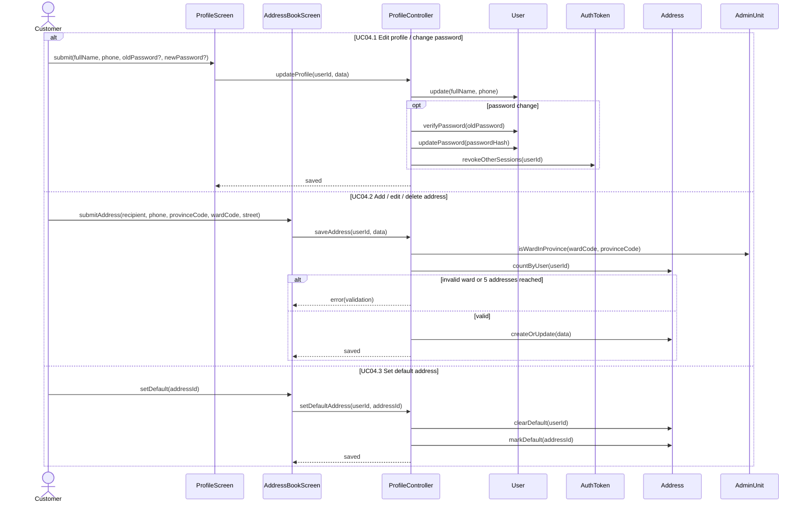

Nguồn: 02-BCE-AND-SEQUENCE.md > Mirra — B2: Phân tích BCE và sequence > 2. Nhóm Tài khoản > UC04 – Manage profile and address book (UC04.1–UC04.3)
### UC04 – Manage profile and address book (UC04.1–UC04.3)

