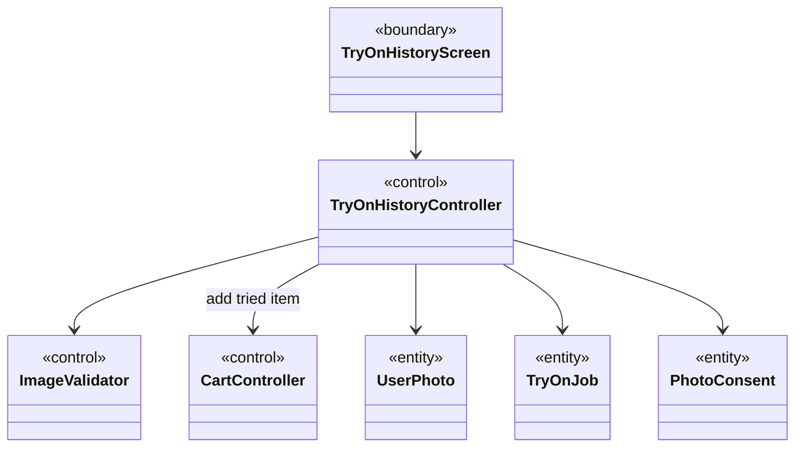
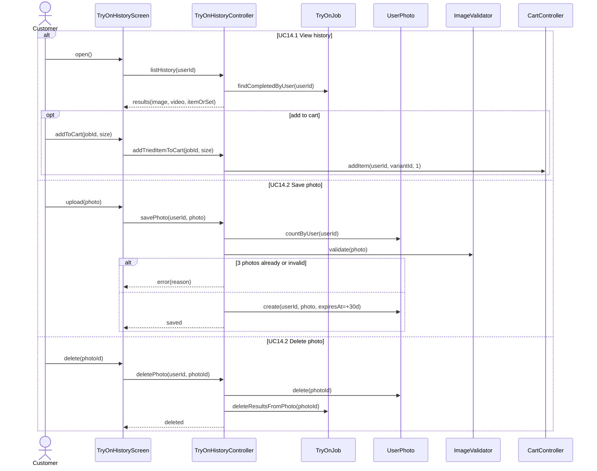

Nguồn: 02-BCE-AND-SEQUENCE.md > Mirra — B2: Phân tích BCE và sequence > 5. Nhóm Thử đồ ảo > UC14 – Manage photos and try-on history (UC14.1–UC14.2)
### UC14 – Manage photos and try-on history (UC14.1–UC14.2)

