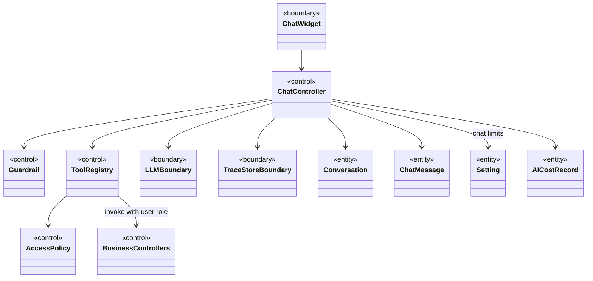
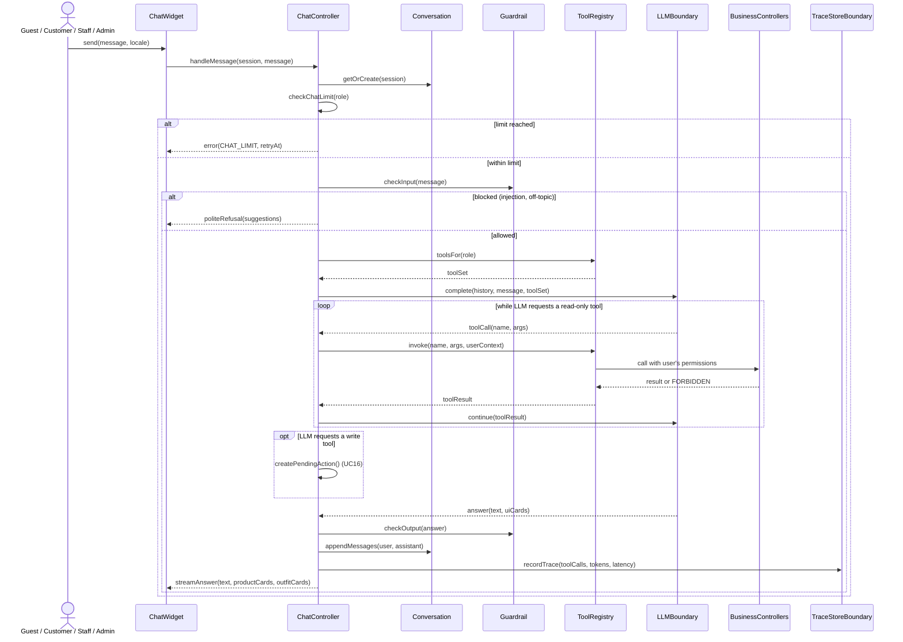

Nguồn: 02-BCE-AND-SEQUENCE.md > Mirra — B2: Phân tích BCE và sequence > 4. Nhóm Trợ lý AI > UC15 – Chat with assistant (gồm UC15.1 Guardrail check)
### UC15 – Chat with assistant (gồm UC15.1 Guardrail check)

`BusinessControllers` đại diện cho các control mà tool gọi tới: ProductBrowseController, OrderTrackingController, OrderProcessingController, InventoryController, ProductDraftController, ReportController, PhotoTryOnController, OutfitSuggestionController.

