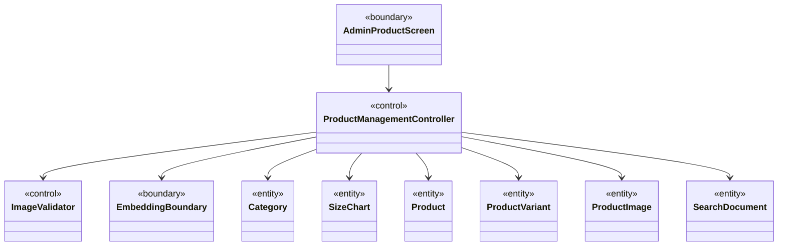
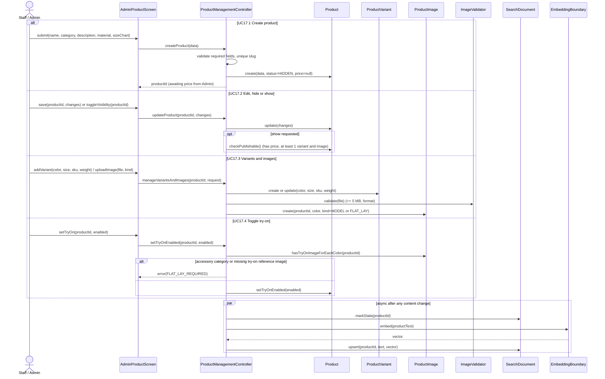

Nguồn: 02-BCE-AND-SEQUENCE.md > Mirra — B2: Phân tích BCE và sequence > 6. Nhóm Vận hành > UC17 – Manage products (UC17.1–UC17.4)
### UC17 – Manage products (UC17.1–UC17.4)

Sản phẩm do Staff tạo luôn ở trạng thái ẩn cho tới khi Admin đặt giá và công khai (UC22.1). Mọi thay đổi nội dung đều cập nhật lại tài liệu tìm kiếm một cách bất đồng bộ.

