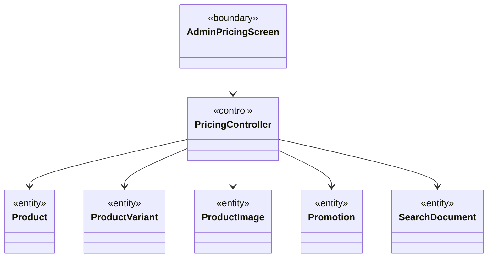
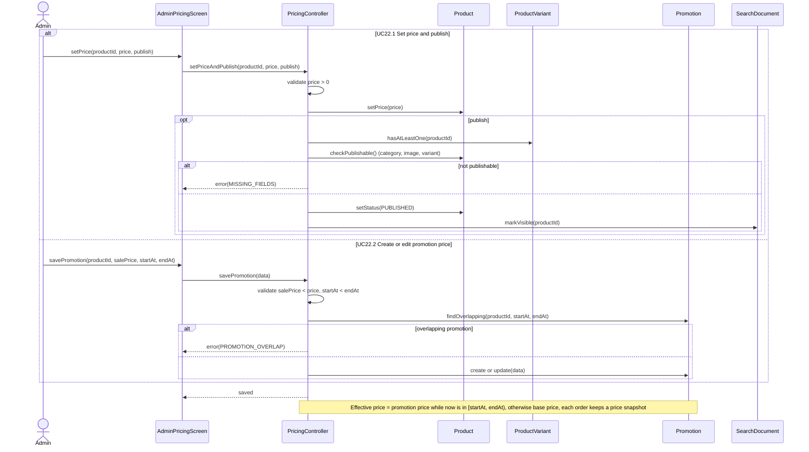

Nguồn: 02-BCE-AND-SEQUENCE.md > Mirra — B2: Phân tích BCE và sequence > 7. Nhóm Quản trị > UC22 – Manage prices and promotions (UC22.1–UC22.2)
### UC22 – Manage prices and promotions (UC22.1–UC22.2)

