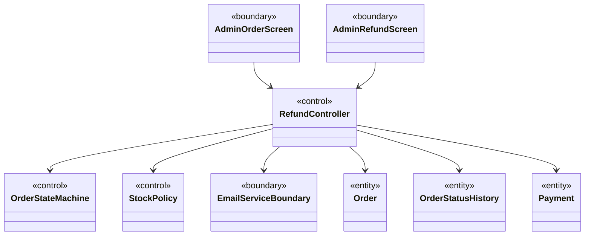
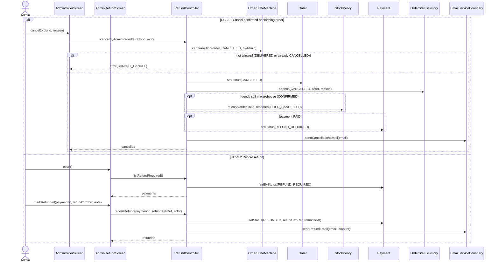

Nguồn: 02-BCE-AND-SEQUENCE.md > Mirra — B2: Phân tích BCE và sequence > 7. Nhóm Quản trị > UC23 – Cancel confirmed order and refund (UC23.1–UC23.2)
### UC23 – Cancel confirmed order and refund (UC23.1–UC23.2)

