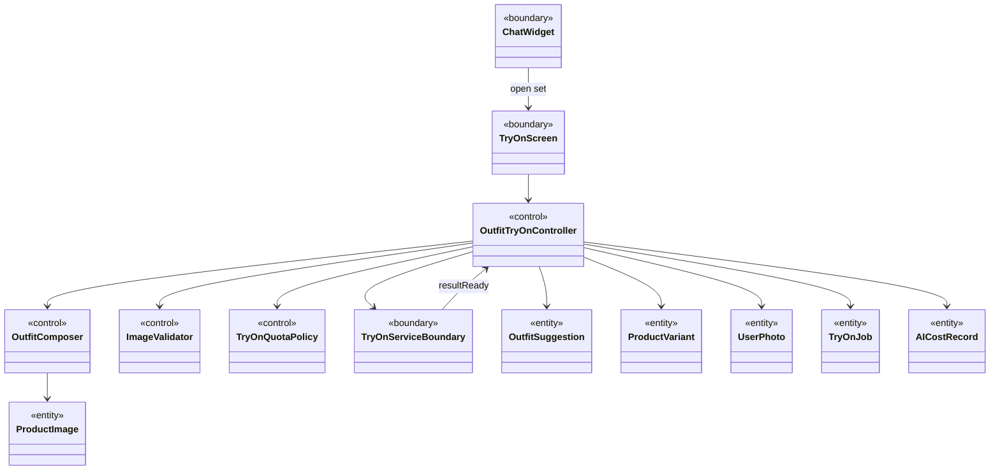
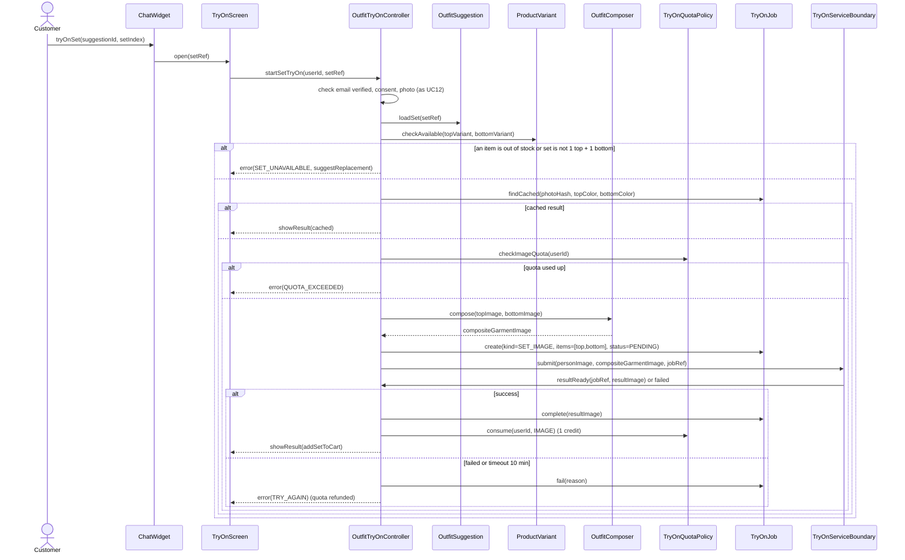

Nguồn: 02-BCE-AND-SEQUENCE.md > Mirra — B2: Phân tích BCE và sequence > 5. Nhóm Thử đồ ảo > UC32 – Try on outfit set
### UC32 – Try on outfit set

Mở từ thẻ set trong chat (UC31). Set gồm đúng 1 áo + 1 quần/váy; ảnh tham chiếu của set (dùng chung ảnh người mẫu nếu 2 món chụp cùng ảnh, nếu không thì ghép ảnh tham chiếu 2 món) được thử một lần, tính 1 lượt ảnh (BR20). Các bước đồng ý, kiểm tra ảnh và cache giống UC12 nên không vẽ lại.

