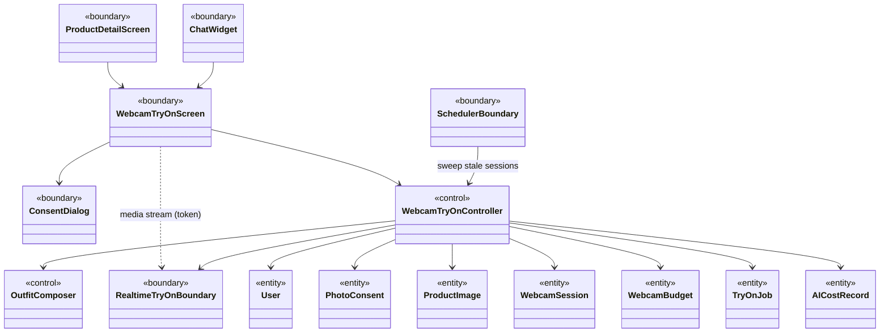
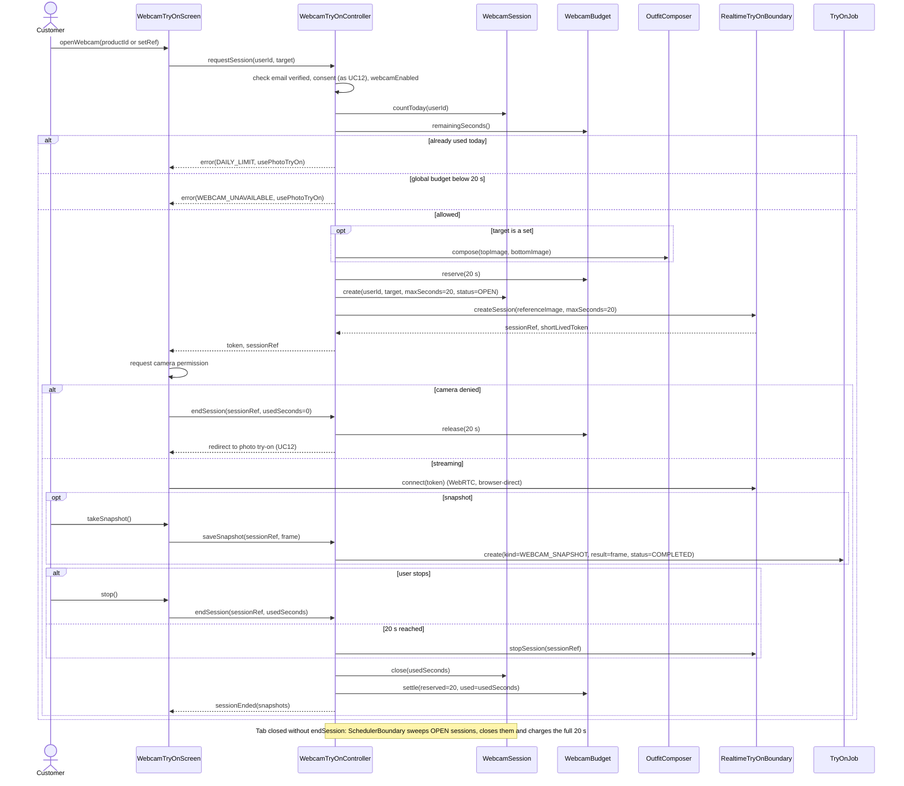

Nguồn: 02-BCE-AND-SEQUENCE.md > Mirra — B2: Phân tích BCE và sequence > 5. Nhóm Thử đồ ảo > UC33 – Try on via webcam
### UC33 – Try on via webcam

Mở từ trang chi tiết sản phẩm hoặc từ thẻ sản phẩm/set trong chat. Luồng video đi thẳng từ trình duyệt tới dịch vụ realtime bằng token ngắn hạn; hệ thống chỉ cấp token, đếm thời gian và dừng phiên (BR21).

