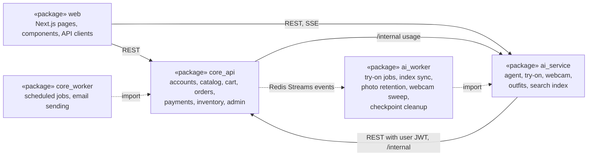

Nguồn: 03-PACKAGE-COMPONENT-DEPLOYMENT.md > Mirra — B3: Package, Component, Deployment > 2. Sơ đồ package > 2.1 Package cấp service
### 2.1 Package cấp service

Bốn package ứng với bốn đơn vị triển khai. Hai worker dùng chung code với service tương ứng (phụ thuộc `import`), chỉ khác lệnh khởi động. Mũi tên liền là gọi qua mạng, nét đứt là phụ thuộc mã hoặc sự kiện bất đồng bộ.

