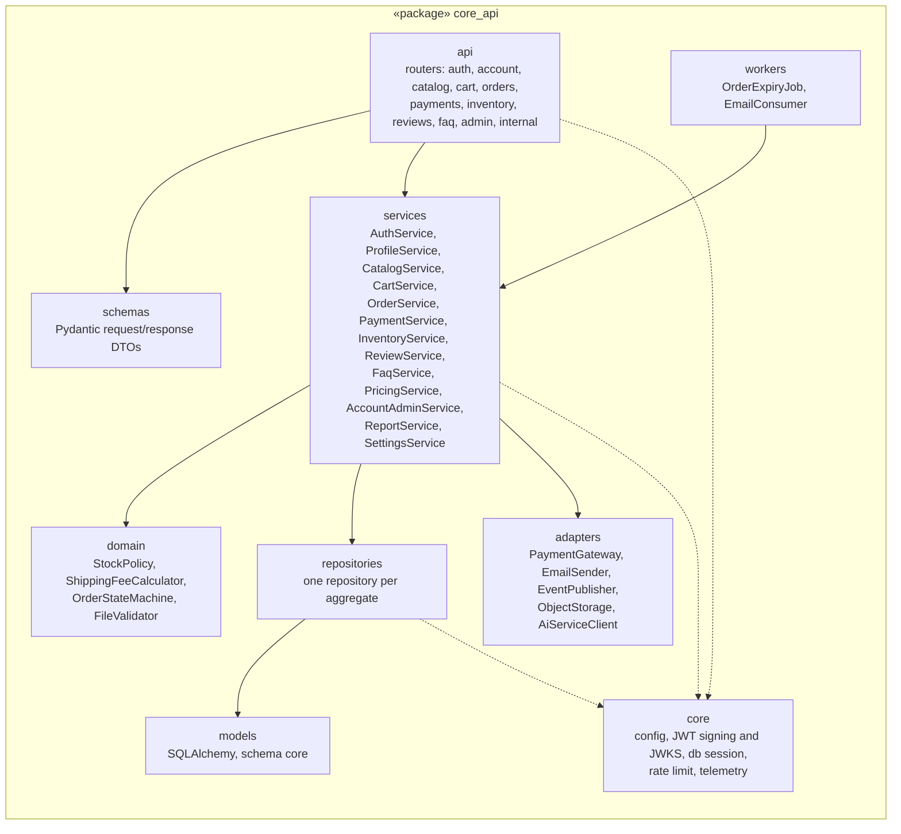

Nguồn: 03-PACKAGE-COMPONENT-DEPLOYMENT.md > Mirra — B3: Package, Component, Deployment > 2. Sơ đồ package > 2.2 core\_api
### 2.2 core\_api

- `api` chỉ kiểm tra đầu vào, lấy người dùng từ JWT và gọi `services`; không chứa nghiệp vụ.
- `services` giữ transaction: một lời gọi service là một đơn vị công việc (ví dụ đặt hàng gồm giữ chỗ kho, tạo đơn, tạo thanh toán trong một transaction).
- `adapters.EventPublisher` ghi sự kiện ra Redis Streams sau khi transaction commit; `AiServiceClient` chỉ dùng cho báo cáo (UC26) lấy số liệu AI qua `/internal`.
- `FileValidator` là phần kiểm tra định dạng, dung lượng của `ImageValidator` ở B2 dùng cho ảnh sản phẩm; phần kiểm tra ảnh người nằm ở ai\_service.

