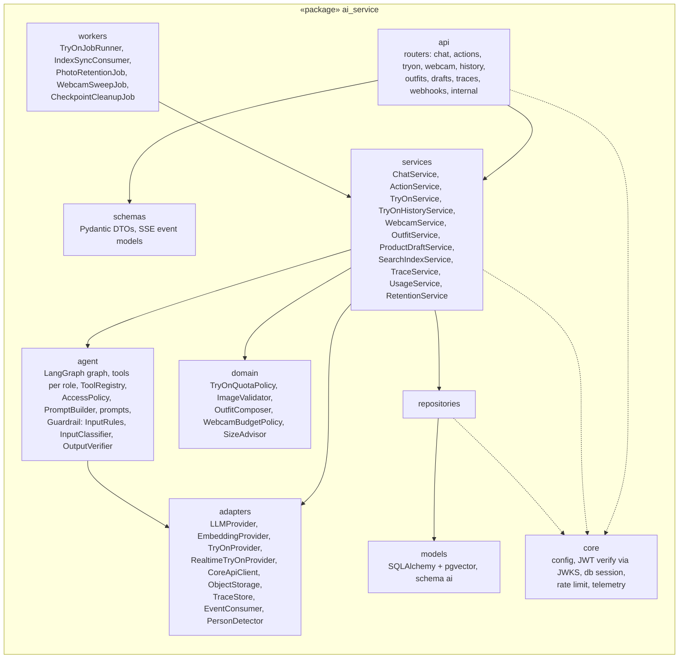

Nguồn: 03-PACKAGE-COMPONENT-DEPLOYMENT.md > Mirra — B3: Package, Component, Deployment > 2. Sơ đồ package > 2.3 ai\_service
### 2.3 ai\_service

- `agent` là package riêng vì đồ thị LangGraph, bộ tool theo vai trò, Guardrail và AccessPolicy thay đổi cùng nhau; `ChatService` và `ActionService` là cửa vào của nó.
- Tool trong `agent` không truy cập schema `core`: mọi dữ liệu nghiệp vụ lấy qua `CoreApiClient` với JWT của người đang chat (BR17).
- `WebcamBudgetPolicy` tách phần giữ chỗ, quyết toán ngân sách 250 giây từ `WebcamTryOnController` ở B2 ra `domain` để `WebcamService` và `WebcamSweepJob` dùng chung.
- Ngoài các package trên, ai-service có package `eval` chỉ dùng khi kiểm thử: `FakeCoreApiClient`, fixture và harness chạy bộ đánh giá agent (B7 mục 7). Package này không được import từ code chạy thật; import-linter kiểm quy tắc này.
- `PersonDetector` (MediaPipe) là adapter vì là thư viện xử lý ảnh bên ngoài; `ImageValidator` gọi nó qua interface.

