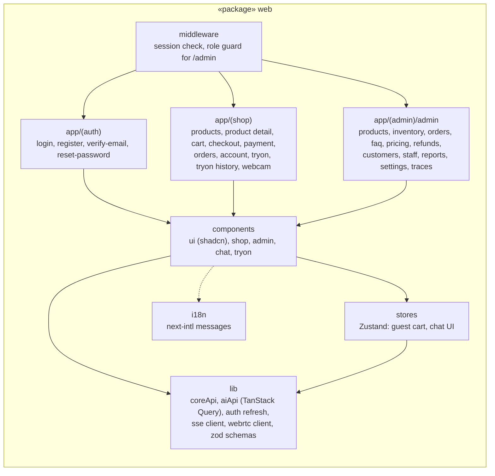

Nguồn: 03-PACKAGE-COMPONENT-DEPLOYMENT.md > Mirra — B3: Package, Component, Deployment > 2. Sơ đồ package > 2.4 web
### 2.4 web

- Nhóm route `(auth)`, `(shop)`, `(admin)` tách layout; `middleware` chặn `/admin` với vai trò không phải Staff/Admin (API vẫn kiểm tra lại, không tin client).
- `lib.coreApi` và `lib.aiApi` là hai client riêng, cùng cơ chế gắn access token và làm mới token; `sse client` dùng cho chat, tiến trình try-on, trạng thái thanh toán; `webrtc client` dùng cho UC33.
- Giỏ hàng của Guest nằm trong `stores` (lưu ở trình duyệt), gộp vào giỏ server khi đăng nhập (UC06.3).

