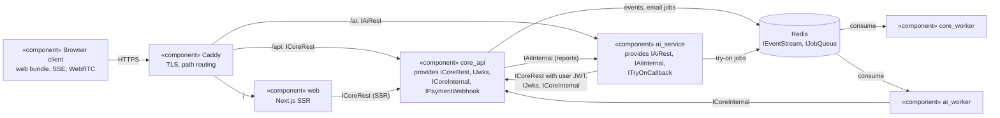

Nguồn: 03-PACKAGE-COMPONENT-DEPLOYMENT.md > Mirra — B3: Package, Component, Deployment > 4. Sơ đồ component > 4.1 Các component của hệ thống
### 4.1 Các component của hệ thống

PostgreSQL và MinIO không vẽ ở đây để sơ đồ gọn; mỗi service và worker truy cập schema và bucket của mình như mục 3.5, xem thêm mục 5. Trình duyệt tải ảnh qua URL ký sẵn của MinIO và nối WebRTC thẳng tới dịch vụ realtime, không đi qua service.

