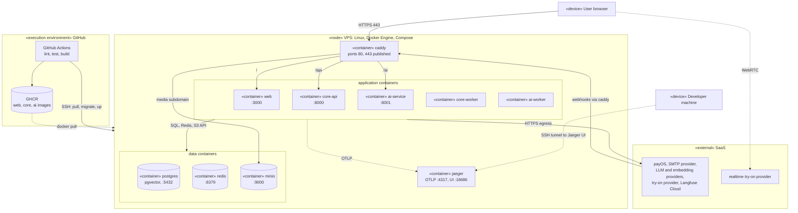

Nguồn: 03-PACKAGE-COMPONENT-DEPLOYMENT.md > Mirra — B3: Package, Component, Deployment > 5. Sơ đồ deployment > 5.1 Production
### 5.1 Production

10 container trên một VPS, chỉ Caddy mở cổng ra ngoài. Webhook của payOS và try-on provider đi vào qua Caddy như mọi request khác.

