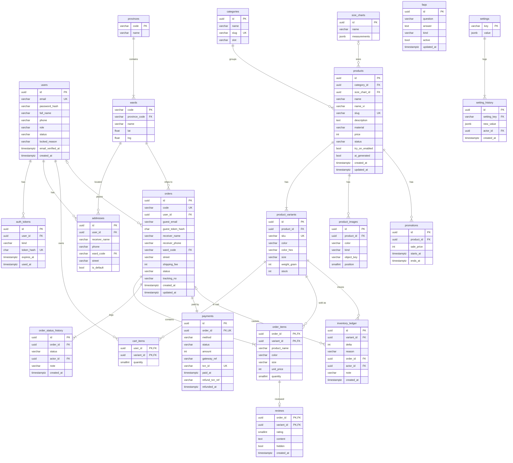

Nguồn: 04-DATABASE.md > Mirra — B4: Thiết kế cơ sở dữ liệu > 2. ERD schema core
## 2. ERD schema core

21 bảng, do core-api sở hữu. Để sơ đồ đọc được, ba quan hệ "người thực hiện" không vẽ: `order_status_history.actor_id`, `inventory_ledger.actor_id`, `setting_history.actor_id` đều tham chiếu `users.id` (xem mục 4).

