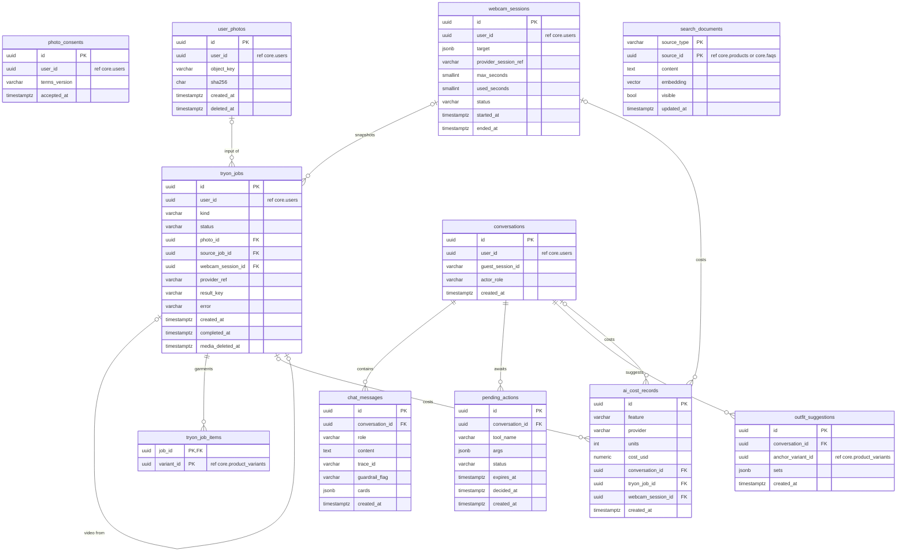

Nguồn: 04-DATABASE.md > Mirra — B4: Thiết kế cơ sở dữ liệu > 3. ERD schema ai
## 3. ERD schema ai

11 bảng, do ai-service sở hữu. Cột ghi `ref core.*` là ID tham chiếu sang schema `core`, không có khóa ngoại. Bảng checkpoint của LangGraph nằm cùng schema nhưng do thư viện quản lý, dùng `conversations.id` làm mã luồng (thread).

