Nguồn: 06-CLASS-AND-DESIGN-PATTERN.md > Mirra — B6: Thiết kế lớp và design pattern > 2. Lớp nền dùng chung
## 2. Lớp nền dùng chung

Cả core-api và ai-service đều có các lớp nền dưới đây trong package `core` của mình (mỗi service một bản, không chia sẻ thư viện để triển khai độc lập).

```mermaid
classDiagram
  class UnitOfWork {
    <<abstract>>
    +session: AsyncSession
    +after_commit(callback: Callable) None
    +commit() None
    +rollback() None
    +advisory_lock(key: int) None
  }
  class SqlAlchemyUnitOfWork
  class Repository~T~ {
    <<abstract>>
    #session: AsyncSession
    +get(id: UUID) T | None
    +add(entity: T) None
    +delete(entity: T) None
    +page(query: Select, page: int, size: int) Page~T~
  }
  class AppError {
    +code: str
    +status: int
    +detail: str
    +errors: list~FieldError~
  }
  class CurrentUser {
    +id: UUID
    +role: Role
    +email_verified: bool
  }
  class SettingsProvider {
    <<interface>>
    +get(key: str) Any
    +public() dict
  }
  class EventPublisher {
    <<interface>>
    +publish(stream: str, type: str, data: dict) None
  }
  class JobQueue {
    <<interface>>
    +enqueue(stream: str, type: str, data: dict) None
  }
  class Notifier {
    <<interface>>
    +notify(channel: str, data: dict) None
    +subscribe(channel: str) AsyncIterator~dict~
  }
  class ObjectStorage {
    <<interface>>
    +put(bucket: str, key: str, data: bytes, content_type: str) None
    +delete(bucket: str, key: str) None
    +public_url(bucket: str, key: str) str
    +signed_url(bucket: str, key: str, ttl: int) str
  }
  class IdempotencyStore {
    <<interface>>
    +get(key: str, scope: str) dict | None
    +save(key: str, scope: str, response: dict, ttl: int) None
  }
  class StreamConsumer {
    <<abstract>>
    +stream: str
    +group: str
    +run() None
    #handle(type: str, data: dict)* None
    #on_dead_letter(message_id: str, error: Exception) None
  }
  class RedisStreamPublisher
  class RedisPubSubNotifier
  class MinioStorage
  class RedisIdempotencyStore

  UnitOfWork <|-- SqlAlchemyUnitOfWork
  EventPublisher <|.. RedisStreamPublisher
  JobQueue <|.. RedisStreamPublisher
  Notifier <|.. RedisPubSubNotifier
  ObjectStorage <|.. MinioStorage
  IdempotencyStore <|.. RedisIdempotencyStore
```

| Lớp | Trách nhiệm |
| --- | --- |
| `UnitOfWork` | Mở một `AsyncSession` cho mỗi request ghi, commit hoặc rollback một lần; chạy các callback `after_commit` (phát sự kiện, xếp hàng job) chỉ khi commit thành công; `advisory_lock` dùng `pg_advisory_xact_lock` cho ngân sách webcam |
| `Repository[T]` | Truy vấn và ghi một aggregate; không commit (việc của UnitOfWork) |
| `AppError` | Lỗi nghiệp vụ mang `code` B5 mục 7.1; một exception handler chung đổi thành problem+json |
| `CurrentUser` | Lấy từ JWT ở tầng api (core tự ký, ai kiểm qua JWKS) rồi truyền xuống service |
| `SettingsProvider` | core đọc bảng `settings`; ai đọc qua `/internal/v1/settings`, đệm Redis, làm mới khi có `settings.updated` |
| `EventPublisher`, `JobQueue` | Ghi Redis Streams (B5 mục 6.2); một lớp `RedisStreamPublisher` hiện thực cả hai |
| `Notifier` | Redis pub/sub cho SSE (B5 mục 6.3) |
| `ObjectStorage` | MinIO; sinh URL công khai hoặc URL ký |
| `IdempotencyStore` | Lưu kết quả theo `Idempotency-Key` 24 giờ |
| `StreamConsumer` | Vòng đọc consumer group: đọc, gọi `handle`, `XACK`, lấy lại tin treo, chuyển tin lỗi quá 5 lần vào `mirra:dead`. Lớp con chỉ viết `handle` (Template Method, mục 6) |

