Nguồn: 06-CLASS-AND-DESIGN-PATTERN.md > Mirra — B6: Thiết kế lớp và design pattern > 3. core-api > 3.1 Identity (UC01–UC04, UC24, UC25)
### 3.1 Identity (UC01–UC04, UC24, UC25)

```mermaid
classDiagram
  class AuthService {
    <<service>>
    +register(cmd: RegisterCmd) UserOut
    +verify_email(token: str) None
    +resend_verification(user: CurrentUser) None
    +login(email: str, password: str, ip: str) TokenPair
    +refresh(raw_refresh: str) TokenPair
    +logout(raw_refresh: str) None
    +forgot_password(email: str) None
    +reset_password(token: str, new_password: str) None
    +set_password(token: str, password: str) None
  }
  class ProfileService {
    <<service>>
    +get_me(user: CurrentUser) UserOut
    +update_me(user: CurrentUser, cmd: UpdateMeCmd) UserOut
    +change_password(user: CurrentUser, current: str, new: str) None
    +list_addresses(user: CurrentUser) list~AddressOut~
    +add_address(user: CurrentUser, cmd: AddressCmd) AddressOut
    +update_address(user: CurrentUser, id: UUID, cmd: AddressCmd) AddressOut
    +delete_address(user: CurrentUser, id: UUID) None
  }
  class AccountAdminService {
    <<service>>
    +search_customers(q: str, status: str, page: int) Page~CustomerOut~
    +set_customer_locked(id: UUID, locked: bool, reason: str) None
    +list_staff(page: int) Page~StaffOut~
    +invite_staff(cmd: StaffCmd) StaffOut
    +update_staff(id: UUID, cmd: StaffCmd) StaffOut
    +set_staff_locked(id: UUID, locked: bool) None
  }
  class OneTimeTokenService {
    <<domain>>
    +issue(user_id: UUID, kind: TokenKind) str
    +consume(raw: str, kind: TokenKind) AuthToken
  }
  class LoginThrottle {
    <<interface>>
    +check(email: str, ip: str) None
    +record_failure(email: str, ip: str) None
    +reset(email: str) None
  }
  class PasswordHasher {
    <<interface>>
    +hash(password: str) str
    +verify(password: str, hashed: str) bool
  }
  class TokenSigner {
    <<interface>>
    +sign_access(user: User) str
    +jwks() dict
  }
  class EmailQueue {
    <<interface>>
    +enqueue(template: EmailTemplate, to: str, params: dict) None
  }
  class UserRepository {
    <<repository>>
    +get_by_email(email: str) User | None
    +search(q: str, role: Role, status: str, page: int) Page~User~
  }
  class AuthTokenRepository {
    <<repository>>
    +get_by_hash(token_hash: str) AuthToken | None
    +revoke_all_refresh(user_id: UUID) None
  }
  class AddressRepository {
    <<repository>>
    +list_by_user(user_id: UUID) list~Address~
    +count_by_user(user_id: UUID) int
  }
  class RedisLoginThrottle
  class Argon2Hasher
  class Rs256Signer
  class RedisEmailQueue

  AuthService --> UserRepository
  AuthService --> OneTimeTokenService
  AuthService --> LoginThrottle
  AuthService --> PasswordHasher
  AuthService --> TokenSigner
  AuthService --> EmailQueue
  OneTimeTokenService --> AuthTokenRepository
  ProfileService --> UserRepository
  ProfileService --> AddressRepository
  ProfileService --> PasswordHasher
  AccountAdminService --> UserRepository
  AccountAdminService --> AuthTokenRepository
  AccountAdminService --> OneTimeTokenService
  AccountAdminService --> EmailQueue
  LoginThrottle <|.. RedisLoginThrottle
  PasswordHasher <|.. Argon2Hasher
  TokenSigner <|.. Rs256Signer
  EmailQueue <|.. RedisEmailQueue
```

- `OneTimeTokenService` dùng chung cho mọi token lưu trong `auth_tokens` (refresh, xác thực email, đặt lại, mời Staff): sinh chuỗi ngẫu nhiên, lưu SHA-256, `consume` kiểm loại, hạn, `used_at` rồi gán `used_at`.
- `AuthService.refresh` phát hiện refresh token bị dùng lại (đã có `used_at`) thì gọi `revoke_all_refresh` (B5 mục 2.1).
- `LoginThrottle` giữ bộ đếm 15 phút trong Redis (B4 mục 4.1).

