Nguồn: 06-CLASS-AND-DESIGN-PATTERN.md > Mirra — B6: Thiết kế lớp và design pattern > 3. core-api > 3.2 Catalog (UC05, UC11, UC17, UC21, UC22)
### 3.2 Catalog (UC05, UC11, UC17, UC21, UC22)

```mermaid
classDiagram
  class CatalogService {
    <<service>>
    +list_categories() list~CategoryOut~
    +list_products(f: ProductFilter, page: int) Page~ProductCard~
    +get_product(slug: str) ProductDetail
    +create_product(cmd: ProductCmd) ProductOut
    +update_product(id: UUID, cmd: ProductPatch) ProductOut
    +delete_product(id: UUID) None
    +add_variant(product_id: UUID, cmd: VariantCmd) VariantOut
    +update_variant(id: UUID, cmd: VariantPatch) VariantOut
    +upload_image(product_id: UUID, file: Upload, kind: ImageKind, color: str) ImageOut
    +set_try_on(product_id: UUID, enabled: bool) None
    +get_variants(ids: list~UUID~) list~VariantInfo~
    +get_index_document(source_type: str, id: UUID) IndexDocument
  }
  class PricingService {
    <<service>>
    +set_price(product_id: UUID, price: int, publish: bool) ProductOut
    +create_promotion(product_id: UUID, cmd: PromotionCmd) PromotionOut
    +update_promotion(id: UUID, cmd: PromotionCmd) PromotionOut
    +delete_promotion(id: UUID) None
    +effective_prices(variant_ids: list~UUID~, at: datetime) dict~UUID, int~
  }
  class ReviewService {
    <<service>>
    +create(order_code: str, actor: Buyer, cmd: ReviewCmd) ReviewOut
    +list_for_product(slug: str, page: int) Page~ReviewOut~
    +set_hidden(order_id: UUID, variant_id: UUID, hidden: bool) None
  }
  class FaqService {
    <<service>>
    +list(kind: str) list~FaqOut~
    +create(cmd: FaqCmd) FaqOut
    +update(id: UUID, cmd: FaqCmd) FaqOut
    +delete(id: UUID) None
  }
  class PriceCalculator {
    <<domain>>
    +effective_price(base: int, promotions: list~Promotion~, at: datetime) int
  }
  class PublishPolicy {
    <<domain>>
    +check(product: Product, variants: int, images: int) None
  }
  class FileValidator {
    <<domain>>
    +validate(upload: Upload) None
  }
  class ProductRepository {
    <<repository>>
    +get_by_slug(slug: str) Product | None
    +search(f: ProductFilter, page: int) Page~Product~
    +has_orders(product_id: UUID) bool
  }
  class VariantRepository {
    <<repository>>
    +get_many(ids: list~UUID~) list~ProductVariant~
    +lock_many(ids: list~UUID~) list~ProductVariant~
  }
  class PromotionRepository {
    <<repository>>
    +active_for(product_ids: list~UUID~, at: datetime) list~Promotion~
    +find_overlapping(product_id: UUID, start: datetime, end: datetime) list~Promotion~
  }
  class ReviewRepository {
    <<repository>>
  }
  class FaqRepository {
    <<repository>>
  }
  class ObjectStorage {
    <<interface>>
  }
  class EventPublisher {
    <<interface>>
  }

  CatalogService --> ProductRepository
  CatalogService --> VariantRepository
  CatalogService --> PricingService
  CatalogService --> FileValidator
  CatalogService --> ObjectStorage
  CatalogService --> EventPublisher
  PricingService --> ProductRepository
  PricingService --> PromotionRepository
  PricingService --> PriceCalculator
  PricingService --> PublishPolicy
  PricingService --> EventPublisher
  ReviewService --> ReviewRepository
  FaqService --> FaqRepository
  FaqService --> EventPublisher
```

- Giá hiệu lực chỉ tính ở `PriceCalculator`, được `PricingService.effective_prices` gọi cho trang sản phẩm, giỏ, quote và đặt hàng, nên mọi nơi ra cùng một con số.
- Mọi thay đổi nội dung sản phẩm hoặc FAQ đăng `after_commit` để phát `product.changed` / `faq.changed`.
- `ReviewService.create` xác minh quyền đánh giá bằng `ReviewRepository.eligible_item(order_code, variant_id, buyer)`, truy vấn chỉ đọc trên `orders` + `order_items` (đơn đã giao, đúng người mua). Không gọi `OrderService` để tránh phụ thuộc vòng Catalog ↔ Ordering (mục 7.2).

