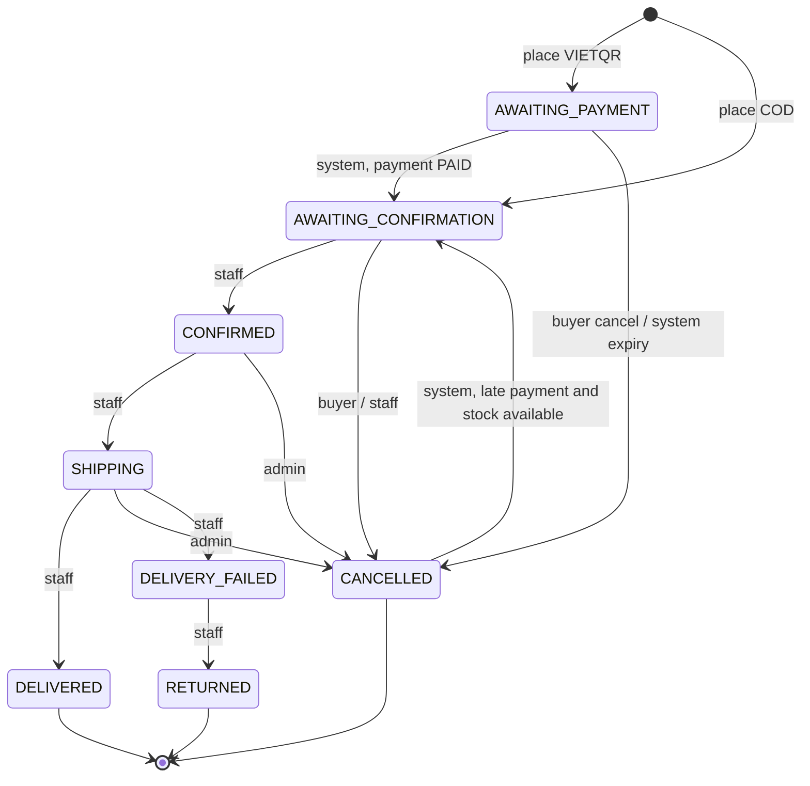

Nguồn: 06-CLASS-AND-DESIGN-PATTERN.md > Mirra — B6: Thiết kế lớp và design pattern > 3. core-api > 3.3 Ordering (UC06–UC10, UC19, UC20, UC23, UC29)
### 3.3 Ordering (UC06–UC10, UC19, UC20, UC23, UC29)

```mermaid
classDiagram
  class CartService {
    <<service>>
    +get(user: CurrentUser) CartOut
    +set_item(user: CurrentUser, variant_id: UUID, quantity: int) CartOut
    +remove_item(user: CurrentUser, variant_id: UUID) CartOut
    +merge(user: CurrentUser, lines: list~CartLine~) CartOut
  }
  class OrderService {
    <<service>>
    +quote(cmd: QuoteCmd) Quote
    +place(cmd: PlaceOrderCmd, buyer: Buyer, idem_key: str) PlacedOrder
    +list_mine(user: CurrentUser, page: int) Page~OrderSummary~
    +get(code: str, access: OrderAccess) OrderDetail
    +cancel_by_buyer(code: str, access: OrderAccess, reason: str) None
    +staff_transition(id: UUID, action: StaffAction, actor: CurrentUser, cmd: TransitionCmd) OrderDetail
    +expire_unpaid(now: datetime) int
  }
  class PaymentService {
    <<service>>
    +get(code: str, access: OrderAccess) PaymentOut
    +start(order: Order) PaymentOut
    +handle_payos_webhook(body: bytes) None
    +reconcile(order: Order) bool
    +list_refund_required(page: int) Page~PaymentOut~
    +record_refund(payment_id: UUID, ref: str, actor: CurrentUser) None
    +stream(code: str, access: OrderAccess) AsyncIterator~PaymentStatusEvent~
  }
  class InventoryService {
    <<service>>
    +list_stock(f: StockFilter, page: int) Page~StockRow~
    +adjust(cmd: AdjustCmd, actor: CurrentUser) StockRow
    +ledger(variant_id: UUID, start: datetime, end: datetime) list~LedgerRow~
  }
  class StockPolicy {
    <<domain>>
    +take(variants: list~ProductVariant~, lines: list~CartLine~) list~LedgerDraft~
    +give_back(items: list~OrderItem~, reason: LedgerReason) list~LedgerDraft~
    +adjust(variant: ProductVariant, delta: int) LedgerDraft
    +is_low(variant: ProductVariant, threshold: int) bool
  }
  class ShippingFeeStrategy {
    <<interface>>
    +quote(ward: Ward, weight_g: int, subtotal: int) ShippingQuote
  }
  class DistanceTierStrategy {
    -warehouse: GeoPoint
    -road_factor: float
    -tiers: list~Tier~
    -weight_rule: WeightRule
    -free_rules: list~FreeRule~
  }
  class OrderStateMachine {
    <<domain>>
    -TRANSITIONS: dict~tuple, Rule~
    +can(order: Order, to: OrderStatus, actor: ActorKind) bool
    +transition(order: Order, to: OrderStatus, actor: ActorKind) list~SideEffect~
  }
  class OrderAccessPolicy {
    <<domain>>
    +check(order: Order, access: OrderAccess, closed_at: datetime | None, now: datetime, link_days: int) None
  }
  class OrderCodeGenerator {
    <<domain>>
    +next() str
  }
  class PaymentGateway {
    <<interface>>
    +create_link(code: int, amount: int, description: str, expires_at: datetime) PaymentLink
    +parse_webhook(body: bytes) PaymentNotice
    +get_status(code: int) PaymentNotice | None
    +cancel_link(code: int) None
  }
  class PayOSGateway
  class OrderRepository {
    <<repository>>
    +get_by_code(code: str) Order | None
    +search(f: OrderFilter, page: int) Page~Order~
    +find_expired_unpaid(before: datetime) list~Order~
    +closed_at(order_id: UUID) datetime | None
  }
  class PaymentRepository {
    <<repository>>
    +get_by_order(order_id: UUID) Payment
    +get_by_txn(txn_id: str) Payment | None
  }
  class CartItemRepository {
    <<repository>>
  }
  class LedgerRepository {
    <<repository>>
  }
  class PricingService {
    <<service>>
  }
  class VariantRepository {
    <<repository>>
  }

  CartService --> CartItemRepository
  CartService --> PricingService
  OrderService --> VariantRepository
  OrderService --> PricingService
  OrderService --> StockPolicy
  OrderService --> ShippingFeeStrategy
  OrderService --> OrderStateMachine
  OrderService --> OrderAccessPolicy
  OrderService --> OrderCodeGenerator
  OrderService --> OrderRepository
  OrderService --> LedgerRepository
  OrderService --> PaymentService
  PaymentService --> PaymentRepository
  PaymentService --> PaymentGateway
  PaymentService --> OrderStateMachine
  InventoryService --> VariantRepository
  InventoryService --> StockPolicy
  InventoryService --> LedgerRepository
  ShippingFeeStrategy <|.. DistanceTierStrategy
  PaymentGateway <|.. PayOSGateway
```

- `VariantRepository` thuộc Catalog nhưng Ordering cần khóa dòng biến thể (`SELECT ... FOR UPDATE`) trong cùng transaction đặt hàng; đây là ngoại lệ duy nhất của quy tắc "không dùng repository của component khác" (mục 7).
- `ShippingFeeStrategy` là chỗ thay heuristic khoảng cách bằng GHN về sau (B1 mục 6.3); tham số đọc từ `SettingsProvider` (`shipping.*`).
- `OrderService.staff_transition` gom các endpoint confirm, ship, deliver, cancel, delivery-failed, return của B5 mục 3.3; quyền theo trạng thái do `OrderStateMachine` quyết.
- `OrderAccessPolicy` (BR12): Customer phải là chủ đơn; Guest phải có `X-Order-Token` khớp `guest_token_hash`. Khi đơn đã ở trạng thái cuối (DELIVERED, CANCELLED, RETURNED), token hết hạn sau `order.guest_link_days` ngày (mặc định 7) tính từ `OrderRepository.closed_at` — thời điểm của dòng `order_status_history` đưa đơn vào trạng thái cuối; quá hạn trả `ORDER_TOKEN_EXPIRED`. Không thêm cột (B4).
- `PaymentService.reconcile` xử lý trường hợp webhook payOS bị mất: hỏi `PaymentGateway.get_status`; payOS báo đã trả thì ghi PAID và chuyển AWAITING\_CONFIRMATION như khi nhận webhook, trả `true`; chưa trả thì gọi `cancel_link` để payOS không nhận tiền nữa, trả `false`. Webhook PAID vẫn đến cho đơn đã CANCELLED (giữa hai bước trên) đi theo dòng CANCELLED → AWAITING\_CONFIRMATION của bảng 3.3.1 và B2 UC08: trừ lại được tồn thì mở lại đơn, không được thì REFUND\_REQUIRED và đơn giữ CANCELLED (BR09, mục 5.2).

#### 3.3.1 Bảng chuyển trạng thái đơn hàng

`OrderStateMachine.TRANSITIONS` chứa đúng bảng dưới; chuyển nào không có trong bảng trả `INVALID_TRANSITION` (hoặc `CANNOT_CANCEL` với người mua). `transition` trả về danh sách hành động phụ, `OrderService` thực hiện trong cùng transaction.

| Từ | Đến | Ai | Hành động phụ |
| --- | --- | --- | --- |
| (mới) | AWAITING\_PAYMENT / AWAITING\_CONFIRMATION | Buyer | Trừ tồn; tạo thanh toán; email `ORDER_PLACED` |
| AWAITING\_PAYMENT | AWAITING\_CONFIRMATION | System (webhook) | Thanh toán → PAID; báo SSE |
| AWAITING\_PAYMENT | CANCELLED | Buyer, System (UC29) | Trả tồn |
| AWAITING\_CONFIRMATION | CONFIRMED | Staff | Đơn COD của Guest cần `phone_call_checked` (BR13) |
| AWAITING\_CONFIRMATION | CANCELLED | Buyer, Staff | Trả tồn; nếu đã PAID → REFUND\_REQUIRED |
| CONFIRMED | SHIPPING | Staff | Lưu `tracking_no` |
| CONFIRMED | CANCELLED | Admin | Trả tồn; nếu đã PAID → REFUND\_REQUIRED |
| SHIPPING | DELIVERED | Staff | COD → thanh toán PAID |
| SHIPPING | CANCELLED | Admin | Nếu đã PAID → REFUND\_REQUIRED (hàng về kho ghi bằng điều chỉnh tồn) |
| SHIPPING | DELIVERY\_FAILED | Staff | Ghi lý do |
| DELIVERY\_FAILED | RETURNED | Staff | Trả tồn; nếu đã PAID (VietQR) → REFUND\_REQUIRED (BR09) |
| CANCELLED | AWAITING\_CONFIRMATION | System (thanh toán đến muộn) | Chỉ khi trừ lại được tồn; không được thì thanh toán → REFUND\_REQUIRED và đơn giữ CANCELLED |

Mọi chuyển ghi một dòng `order_status_history` và xếp email `ORDER_STATUS_CHANGED` / `ORDER_CANCELLED`.

