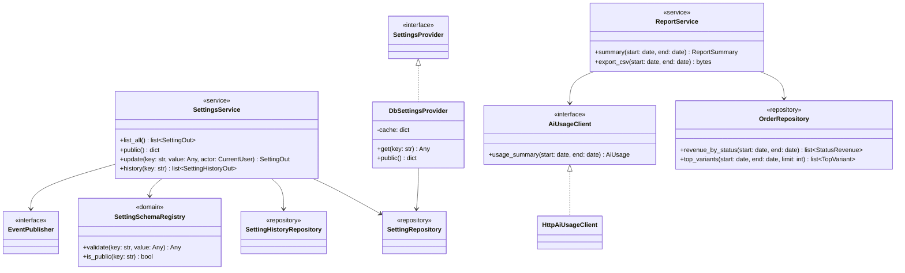

Nguồn: 06-CLASS-AND-DESIGN-PATTERN.md > Mirra — B6: Thiết kế lớp và design pattern > 3. core-api > 3.4 Administration (UC26, UC27)
### 3.4 Administration (UC26, UC27)

- `SettingSchemaRegistry` chứa schema Pydantic của từng khóa ở B5 mục 7.2 và cờ công khai.
- `ReportService` đọc `OrderRepository` của Ordering bằng truy vấn tổng hợp chỉ đọc; là ngoại lệ thứ hai được chấp nhận ở mục 7 (báo cáo cần đọc chéo).
- Nếu ai-service không trả lời, báo cáo vẫn trả phần số liệu bán hàng và đánh dấu phần AI là không có.

