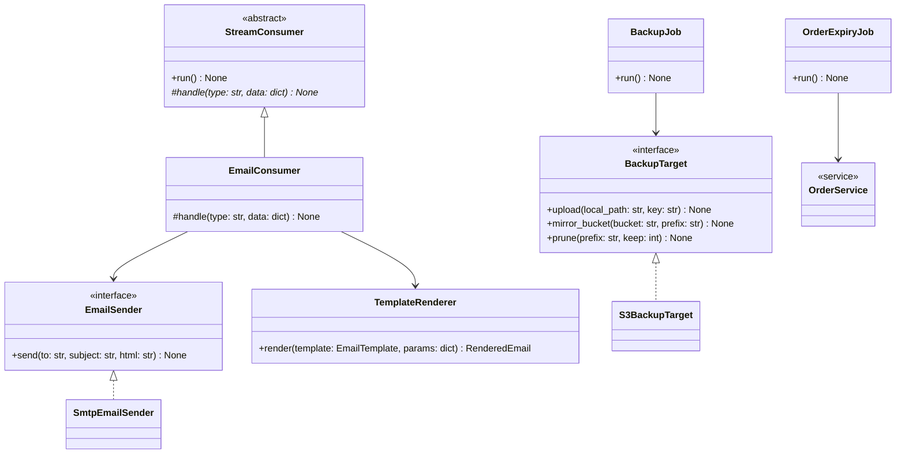

Nguồn: 06-CLASS-AND-DESIGN-PATTERN.md > Mirra — B6: Thiết kế lớp và design pattern > 3. core-api > 3.5 core-worker
### 3.5 core-worker

`OrderExpiryJob` chạy mỗi phút bằng APScheduler, gọi `OrderService.expire_unpaid(now)`; mỗi đơn quá hạn xử lý trong một transaction riêng để một đơn lỗi không chặn các đơn khác. Trước khi hủy, `expire_unpaid` gọi `PaymentService.reconcile(order)`: payOS báo đã trả thì giữ đơn và ghi PAID; payOS không trả lời được thì bỏ qua đơn đó, lần chạy sau thử lại (không hủy khi chưa chắc).

`BackupJob` chạy 02:00 hằng đêm: `pg_dump` cả hai schema bằng user DB riêng `mirra_backup` chỉ có quyền đọc, đẩy bản dump và mirror bucket `products` sang `BackupTarget` nằm ngoài VPS, giữ 7 bản gần nhất. Không sao lưu bucket `tryon`: ảnh người dùng phải bị xóa sau 30 ngày (BR16), giữ trong bản sao lưu là trái quy tắc này.

