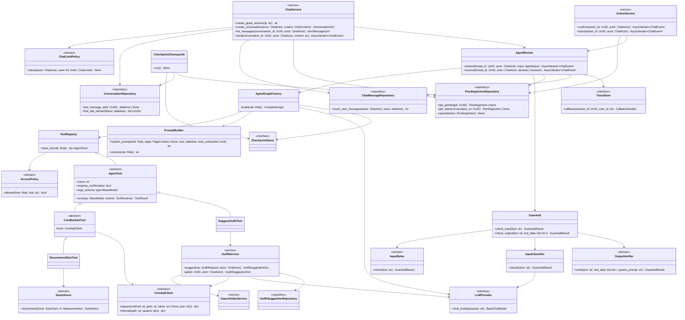

Nguồn: 06-CLASS-AND-DESIGN-PATTERN.md > Mirra — B6: Thiết kế lớp và design pattern > 4. ai-service > 4.1 Assistant (UC15, UC16, UC31)
### 4.1 Assistant (UC15, UC16, UC31)

- `ChatActor` gồm `role`, `user_id` hoặc `guest_session_id`, và access token của request hiện tại. `AgentRunner` dựng từ đó `AgentContext` (runtime context của LangGraph, không được checkpoint); tool đọc token qua `ToolRuntime`. State của graph là `AgentState` gồm `messages` và `page_context` (B7 mục 2.3).
- `AgentRunner` là cầu nối giữa service và LangGraph: chạy graph với `thread_id` = `conversations.id`, đổi sự kiện của graph thành `ChatEvent` (B5 mục 5.2), gặp `interrupt` thì tạo `PendingAction` và phát `action.pending`; khi xác nhận thì resume graph với quyết định.
- Tool có `requires_confirmation = True` (thao tác ghi) luôn đi qua node `confirm` với `interrupt` trước khi chạy. 12 tool theo vai trò, graph 4 node, prompt và guardrail 4 lớp chi tiết ở B7 mục 3–6. `RecommendSizeTool` dùng domain `SizeAdvisor` so số đo với bảng size bằng code, không gọi LLM.
- `CheckpointSaver` là saver Postgres của LangGraph trên schema `ai`.
- `Guardrail` gồm `InputRules` (luật cố định), `InputClassifier` (model phân loại, timeout 1,5 giây) và `OutputVerifier` (đối chiếu số tiền, tồn với dữ liệu tool), B7 mục 6.
- `ChatService.send` gọi `PendingActionRepository.get_open`; còn thao tác chờ thì đánh EXPIRED và `AgentRunner.resume(superseded)` trước khi chạy lượt mới. Hội thoại không có tin quá `chat.conversation_idle_days` thì trả `CONVERSATION_CLOSED`.
- `CheckpointCleanupJob` chạy hằng đêm trong ai-worker: giữ bản checkpoint mới nhất của mỗi thread, xóa thread của hội thoại đã đóng và chuyển thao tác còn PENDING của chúng sang EXPIRED (B7 mục 3.6).

