Nguồn: 06-CLASS-AND-DESIGN-PATTERN.md > Mirra — B6: Thiết kế lớp và design pattern > 4. ai-service > 4.2 TryOn (UC12–UC14, UC30, UC32) và ai-worker
### 4.2 TryOn (UC12–UC14, UC30, UC32) và ai-worker

```mermaid
classDiagram
  class TryOnService {
    <<service>>
    +consent_status(user: CurrentUser) ConsentOut
    +accept_consent(user: CurrentUser, version: str) None
    +upload_photo(user: CurrentUser, file: Upload) PhotoOut
    +list_photos(user: CurrentUser) list~PhotoOut~
    +delete_photo(user: CurrentUser, id: UUID) None
    +create_job(user: CurrentUser, cmd: CreateJobCmd, idem_key: str) JobResult
    +create_video(user: CurrentUser, job_id: UUID, idem_key: str) TryOnJobOut
    +get_job(user: CurrentUser, id: UUID) TryOnJobOut
    +history(user: CurrentUser, page: int) Page~TryOnJobOut~
    +quota(user: CurrentUser) QuotaOut
    +handle_callback(body: bytes, headers: dict) None
    +stream(user: CurrentUser, id: UUID) AsyncIterator~JobEvent~
  }
  class RetentionService {
    <<service>>
    +purge_expired(now: datetime) int
  }
  class TryOnQuotaPolicy {
    <<domain>>
    +remaining(used_today: int, kind: JobKind, limits: QuotaLimits) int
    +ensure_available(used_today: int, kind: JobKind, limits: QuotaLimits) None
  }
  class SetRule {
    <<domain>>
    +validate(items: list~VariantInfo~) None
  }
  class ImageValidator {
    <<domain>>
    +validate_person(image: bytes) None
    +strip_metadata(image: bytes) bytes
  }
  class OutfitComposer {
    <<domain>>
    +compose(top: Image, bottom: Image) bytes
  }
  class PersonDetector {
    <<interface>>
    +detect(image: bytes) list~PersonBox~
  }
  class TryOnJobRunner {
    <<abstract>>
    +run(job_id: UUID) None
    #load_inputs(job: TryOnJob)* JobInputs
    #submit(inputs: JobInputs)* str
    #on_result(job: TryOnJob, result: ProviderResult) None
    #on_failure(job: TryOnJob, error: Exception) None
  }
  class ImageJobRunner
  class SetImageJobRunner
  class VideoJobRunner
  class TryOnJobConsumer {
    #handle(type: str, data: dict) None
  }
  class StreamConsumer {
    <<abstract>>
  }
  class TryOnProvider {
    <<interface>>
    +submit_image(person: bytes, garment: bytes, callback_url: str) str
    +submit_video(image: bytes, callback_url: str) str
    +parse_callback(body: bytes, headers: dict) ProviderResult
    +fetch_result(ref: str) ProviderResult
  }
  class TryOnJobRepository {
    <<repository>>
    +find_cached(photo_sha256: str, variant_ids: list~UUID~) TryOnJob | None
    +count_completed_today(user_id: UUID, kinds: list~JobKind~, day_start: datetime) int
    +get_by_provider_ref(ref: str) TryOnJob | None
    +find_stale(before: datetime) list~TryOnJob~
  }
  class UserPhotoRepository {
    <<repository>>
  }
  class PhotoConsentRepository {
    <<repository>>
  }
  class CoreApiClient {
    <<interface>>
  }
  class CostRecorder {
    <<service>>
  }
  class CostGuard {
    <<service>>
  }

  TryOnService --> TryOnQuotaPolicy
  TryOnService --> SetRule
  TryOnService --> ImageValidator
  TryOnService --> TryOnJobRepository
  TryOnService --> UserPhotoRepository
  TryOnService --> PhotoConsentRepository
  TryOnService --> CoreApiClient
  TryOnService --> TryOnProvider
  TryOnService --> CostRecorder
  TryOnService --> CostGuard
  ImageValidator --> PersonDetector
  RetentionService --> UserPhotoRepository
  RetentionService --> TryOnJobRepository
  StreamConsumer <|-- TryOnJobConsumer
  TryOnJobConsumer --> TryOnJobRunner
  TryOnJobRunner <|-- ImageJobRunner
  TryOnJobRunner <|-- SetImageJobRunner
  TryOnJobRunner <|-- VideoJobRunner
  TryOnJobRunner --> TryOnProvider
  TryOnJobRunner --> TryOnJobRepository
  SetImageJobRunner --> OutfitComposer
```

- `TryOnService.create_job`: kiểm email đã xác thực và đồng ý → lấy món qua `/internal/v1/variants` → `SetRule` (SET\_IMAGE) → tra cache → `TryOnQuotaPolicy` → tạo job PENDING → `after_commit` xếp `tryon.run`.
- `TryOnService.upload_photo` gọi `ImageValidator.strip_metadata` trước khi lưu: bỏ EXIF (có thể chứa tọa độ GPS, thông tin thiết bị) để không giữ dữ liệu cá nhân ngoài chính bức ảnh (NFR09). Khung hình chụp từ webcam cũng đi qua bước này.
- `TryOnJobRunner` (ai-worker) định khung cố định: nạp đầu vào → gửi provider → ghi `provider_ref`, chuyển PROCESSING; lớp con chỉ khác ở cách nạp đầu vào (`SetImageJobRunner` dùng thẳng ảnh khi 2 món có cùng `tryon_image_url`, nếu không thì ghép 2 ảnh bằng `OutfitComposer`, `VideoJobRunner` lấy ảnh kết quả của job nguồn).
- Kết quả về qua webhook (`handle_callback` → `on_result`) hoặc, nếu provider không có webhook, job định kỳ gọi `fetch_result` cho job PROCESSING. Job quá 10 phút do `find_stale` tìm ra được gọi `fetch_result` một lần trước (webhook có thể bị mất trong khi ảnh đã xong, NFR07); vẫn chưa có kết quả mới chuyển FAILED với `TIMEOUT`.
- `RetentionService.purge_expired` chạy hằng ngày trong ai-worker (UC30).

