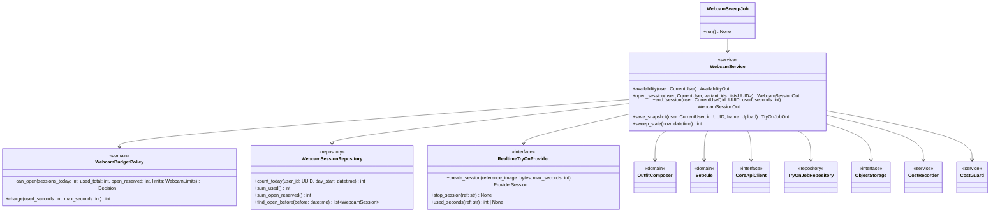

Nguồn: 06-CLASS-AND-DESIGN-PATTERN.md > Mirra — B6: Thiết kế lớp và design pattern > 4. ai-service > 4.3 Webcam (UC33)
### 4.3 Webcam (UC33)

- `open_session` chạy trong một `UnitOfWork` có `advisory_lock(WEBCAM_BUDGET_LOCK)`: đếm phiên hôm nay, tổng giây đã dùng, tổng giây đang giữ → `WebcamBudgetPolicy.can_open` → tạo phiên OPEN → commit, rồi mới gọi provider. Provider lỗi thì đóng phiên với `used_seconds = 0` (trả lại ngân sách).
- `WebcamSweepJob` chạy mỗi phút: phiên OPEN quá `max_seconds` + thời gian ân hạn thì gọi `stop_session`, đóng EXPIRED và tính đủ `max_seconds`.

