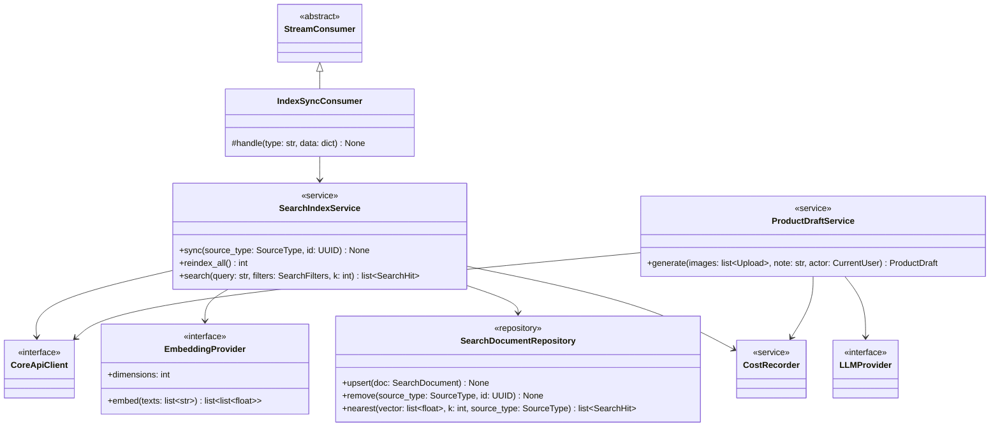

Nguồn: 06-CLASS-AND-DESIGN-PATTERN.md > Mirra — B6: Thiết kế lớp và design pattern > 4. ai-service > 4.4 Knowledge (tìm kiếm ngữ nghĩa, UC18)
### 4.4 Knowledge (tìm kiếm ngữ nghĩa, UC18)

- `sync` lấy nội dung mới nhất qua `/internal/v1/index-documents`, 404 thì xóa tài liệu, còn lại tạo embedding và upsert; nhận cùng sự kiện hai lần vẫn ra cùng kết quả.
- `search` chỉ trả tài liệu `visible`; agent lấy giá và tồn mới từ core sau đó.
- `ProductDraftService` gọi LLM với structured output, danh mục lấy từ API công khai của core; không lưu gì (B3 mục 3.6).

