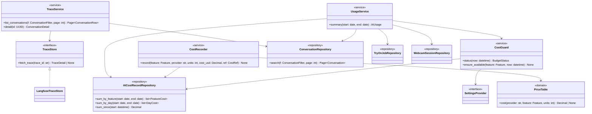

Nguồn: 06-CLASS-AND-DESIGN-PATTERN.md > Mirra — B6: Thiết kế lớp và design pattern > 4. ai-service > 4.5 Observability (UC26, UC28)
### 4.5 Observability (UC26, UC28)

- `CostRecorder` được mọi component AI gọi sau mỗi lần dùng provider; `PriceTable` giữ đơn giá theo provider, chưa có đơn giá thì ghi `units` và để chi phí trống thay vì đoán.
- `UsageService` phục vụ `/internal/v1/usage/summary` (B5 mục 4.3); đọc repository của TryOn, Webcam, Assistant chỉ để đếm, là ngoại lệ đọc chéo kiểu báo cáo như mục 3.4.
- `CostGuard` (NFR13) nằm ở package `core` dùng chung như `CostRecorder`: cộng chi phí từ đầu tháng (giờ Việt Nam) bằng `sum_since`, so với `ai.budget_usd_month`. Từ 80% trần, `UsageService.summary` trả cờ cảnh báo để dashboard Admin hiện (UC26). Từ 100%, `ensure_available` ném `AI_BUDGET_EXCEEDED` cho thử đồ ảnh, video, webcam và sinh nháp sản phẩm; chat và đồng bộ index vẫn chạy vì rẻ và cần cho việc mua hàng. Bản ghi chưa có đơn giá (`cost_usd` trống) không được cộng, nên `PriceTable` phải đủ đơn giá mọi provider trước khi chạy thật.
- `UsageService.summary` trả thêm `by_day` (chi phí theo ngày, từ `sum_by_day`) và `budget` (đã dùng trong tháng, trần, tỉ lệ) cho báo cáo NFR13.

