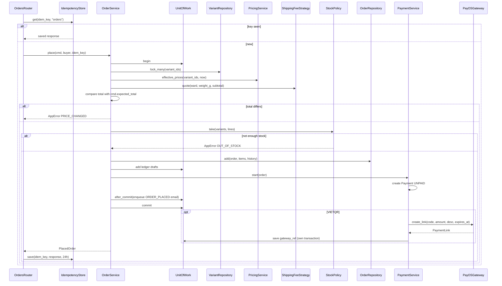

Nguồn: 06-CLASS-AND-DESIGN-PATTERN.md > Mirra — B6: Thiết kế lớp và design pattern > 5. Sequence mức thiết kế > 5.1 Đặt hàng (UC07)
### 5.1 Đặt hàng (UC07)

Gọi payOS sau commit để không giữ khóa dòng biến thể trong lúc chờ mạng; nếu payOS lỗi, đơn vẫn tồn tại ở AWAITING\_PAYMENT và trang thanh toán gọi lại `PaymentService.get` để tạo link (B5 mục 5.1, `PAYMENT_GATEWAY_ERROR`).

