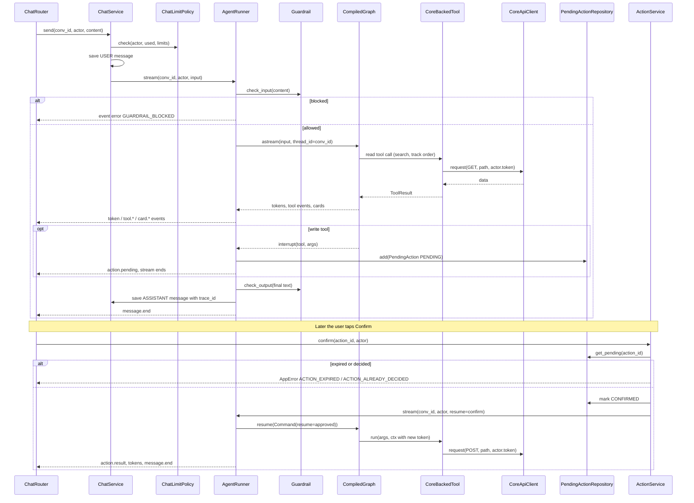

Nguồn: 06-CLASS-AND-DESIGN-PATTERN.md > Mirra — B6: Thiết kế lớp và design pattern > 5. Sequence mức thiết kế > 5.3 Chat và xác nhận hành động (UC15, UC16)
### 5.3 Chat và xác nhận hành động (UC15, UC16)

Phần gửi tin của sơ đồ này được chi tiết hóa ở [B7 mục 3.4](https://claude.ai/artifact/JqesBMTsjrfCLztNEuy1sk): guardrail đầu vào hai bước (luật rồi model phân loại), tự đóng thao tác đang chờ, `message.replace` khi đầu ra vi phạm. Phần bấm xác nhận giữ nguyên.

