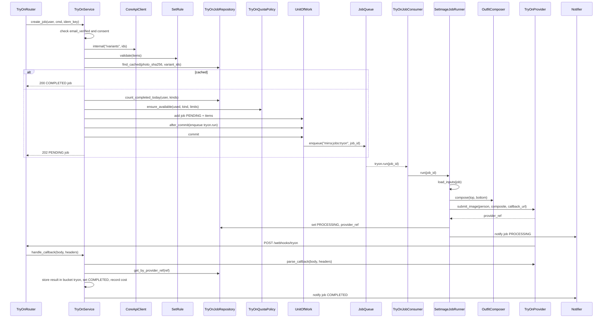

Nguồn: 06-CLASS-AND-DESIGN-PATTERN.md > Mirra — B6: Thiết kế lớp và design pattern > 5. Sequence mức thiết kế > 5.4 Thử set qua job (UC32; UC12 giống nhưng không ghép ảnh)
### 5.4 Thử set qua job (UC32; UC12 giống nhưng không ghép ảnh)

