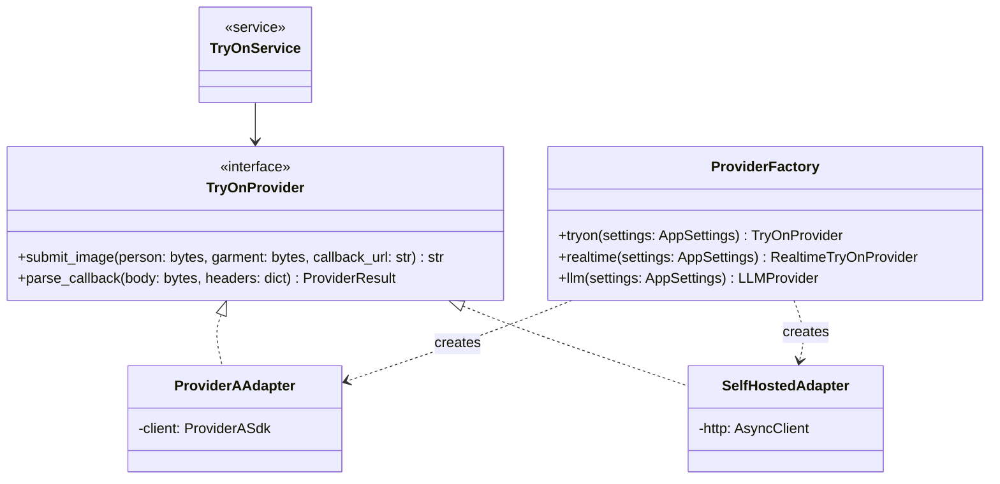

Nguồn: 06-CLASS-AND-DESIGN-PATTERN.md > Mirra — B6: Thiết kế lớp và design pattern > 6. Design pattern > 6.1 Adapter và Strategy
### 6.1 Adapter và Strategy

`ProviderAAdapter` là tên giữ chỗ cho provider trả phí chọn sau benchmark; `SelfHostedAdapter` dành cho mô hình tự host gọi qua HTTP (B3 mục 6). Adapter là mỗi lớp bọc một SDK; Strategy là việc `TryOnService` dùng chung một interface và đổi hiện thực qua cấu hình.

