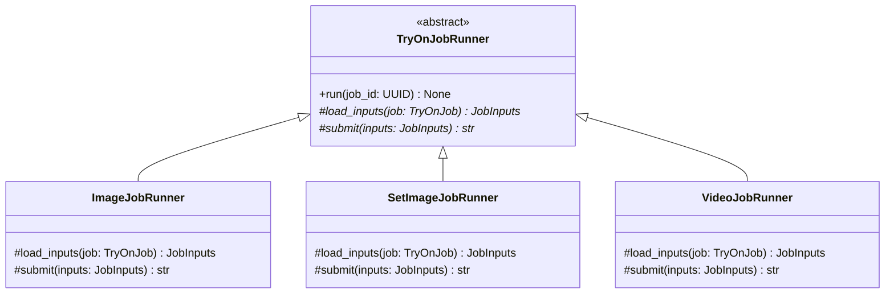

Nguồn: 06-CLASS-AND-DESIGN-PATTERN.md > Mirra — B6: Thiết kế lớp và design pattern > 6. Design pattern > 6.3 Template Method
### 6.3 Template Method

`run` cố định: nạp job, bỏ qua nếu không còn PENDING, gọi `load_inputs`, gọi `submit`, lưu `provider_ref` và PROCESSING, báo tiến trình; mọi lỗi đi vào `on_failure` (FAILED, không trừ lượt). `StreamConsumer` làm tương tự cho vòng đọc Redis Streams.

