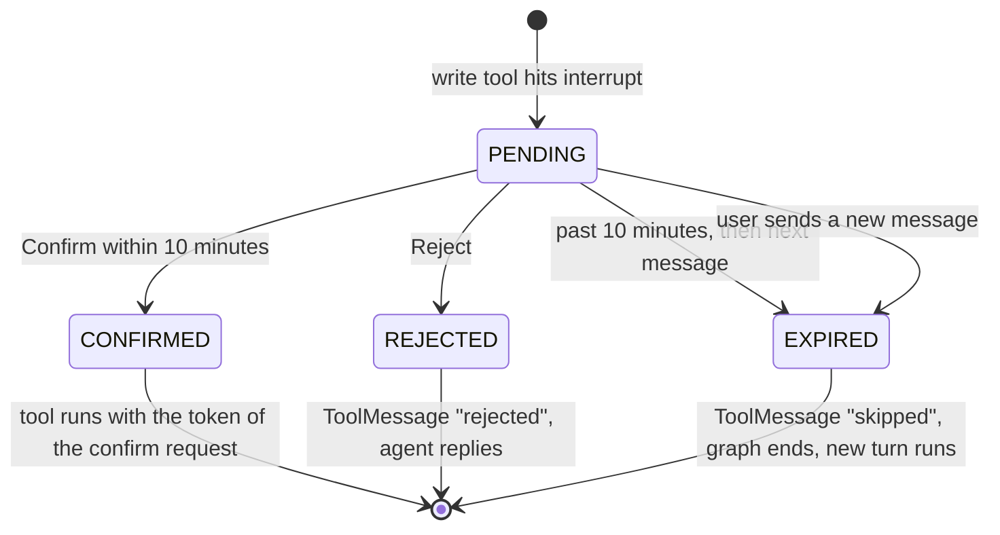

Nguồn: 07-AI-AGENT.md > Mirra — B7: Thiết kế AI agent > 2. State của agent > 2.6 Thao tác chờ xác nhận
### 2.6 Thao tác chờ xác nhận

1. **Payload của `interrupt`** gồm `action_id`, `tool`, `args` và `summary`. `summary` là câu tiếng Việt hiện trên thẻ xác nhận, ví dụ "Thêm Áo sơ mi lụa, màu kem, size M, số lượng 1 vào giỏ".
2. **Mọi `tool_call` đều phải có `ToolMessage` đi kèm**, kể cả khi bị từ chối hay hết hạn. Nếu thiếu, lần gọi model sau sẽ bị provider báo lỗi. Khi đó graph ghi một `ToolMessage` ngắn: "Người dùng đã từ chối" hoặc "Đã bỏ qua vì người dùng gửi yêu cầu khác".
3. **Hạn 10 phút:** `expires_at = created_at + chat.action_ttl_minutes` (setting mới, mặc định 10). Bấm xác nhận sau hạn thì nhận `ACTION_EXPIRED`; graph vẫn đứng ở `interrupt` tới tin nhắn kế tiếp.
4. **Gõ tin mới khi còn PENDING** (kể cả khi đã quá hạn):
   - `ChatService.send` tìm thao tác đang mở của hội thoại và đánh EXPIRED.
   - Resume graph với `{"decision": "superseded"}`. Graph ghi `ToolMessage` "đã bỏ qua" rồi kết thúc mà không gọi model.
   - Sau đó xử lý tin mới như một lượt bình thường. Hai lần chạy nằm trong cùng một luồng SSE; đầu luồng có sự kiện `action.result` với trạng thái EXPIRED để web đóng thẻ xác nhận cũ.
5. **Khi xác nhận**, tool chạy với access token của request xác nhận, lấy từ runtime context, không dùng token của lượt đã tạo thao tác.

