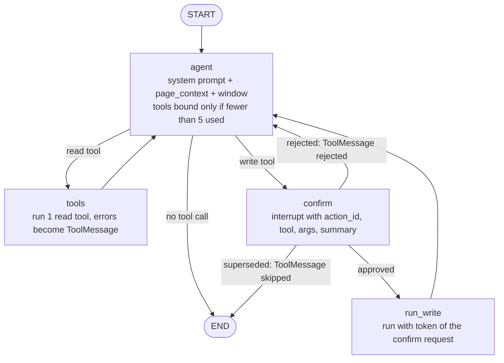

Nguồn: 07-AI-AGENT.md > Mirra — B7: Thiết kế AI agent > 3. Graph > 3.2 Sơ đồ graph
### 3.2 Sơ đồ graph



| Node | Việc | Ghi gì vào state |
| --- | --- | --- |
| `agent` | Dựng input cho model: system prompt theo vai trò (mục 5), `page_context`, cửa sổ lịch sử (mục 2.4). Đếm số tool đã gọi trong lượt: dưới 5 thì gắn tool của vai trò, đủ 5 thì gọi model không gắn tool (mục 2.7) | `AIMessage` (có hoặc không có `tool_call`) |
| `tools` | Chạy tool đọc. Lỗi của tool không làm hỏng lượt mà thành `ToolMessage` mô tả lỗi (mục 3.5) | `ToolMessage` (nội dung rút gọn + artifact thẻ) |
| `confirm` | Dừng chờ người dùng bằng `interrupt`; khi resume thì đi tiếp theo quyết định | `ToolMessage` "đã từ chối" hoặc "đã bỏ qua"; không ghi gì khi được duyệt |
| `run_write` | Chạy tool ghi bằng access token của request xác nhận | `ToolMessage` kết quả |

Hàm `route` sau node `agent`: không có `tool_call` thì kết thúc; tool có `requires_confirmation` thì sang `confirm`; còn lại sang `tools`. Phòng khi provider bỏ qua cờ tắt song song và vẫn trả nhiều `tool_call`: chỉ chạy cái đầu, các cái còn lại nhận `ToolMessage` "mỗi lần chỉ gọi một công cụ" để không thiếu cặp (mục 2.6).

```python
g = StateGraph(AgentState, context_schema=AgentContext)
g.add_node("agent", agent_node)
g.add_node("tools", tools_node)
g.add_node("confirm", confirm_node)
g.add_node("run_write", run_write_node)
g.add_edge(START, "agent")
g.add_conditional_edges("agent", route, ["tools", "confirm", END])
g.add_edge("tools", "agent")
g.add_edge("run_write", "agent")
# confirm tự chọn đường bằng Command(goto="run_write" | "agent" | END, update=...)
graph = g.compile(checkpointer=postgres_saver)
```

