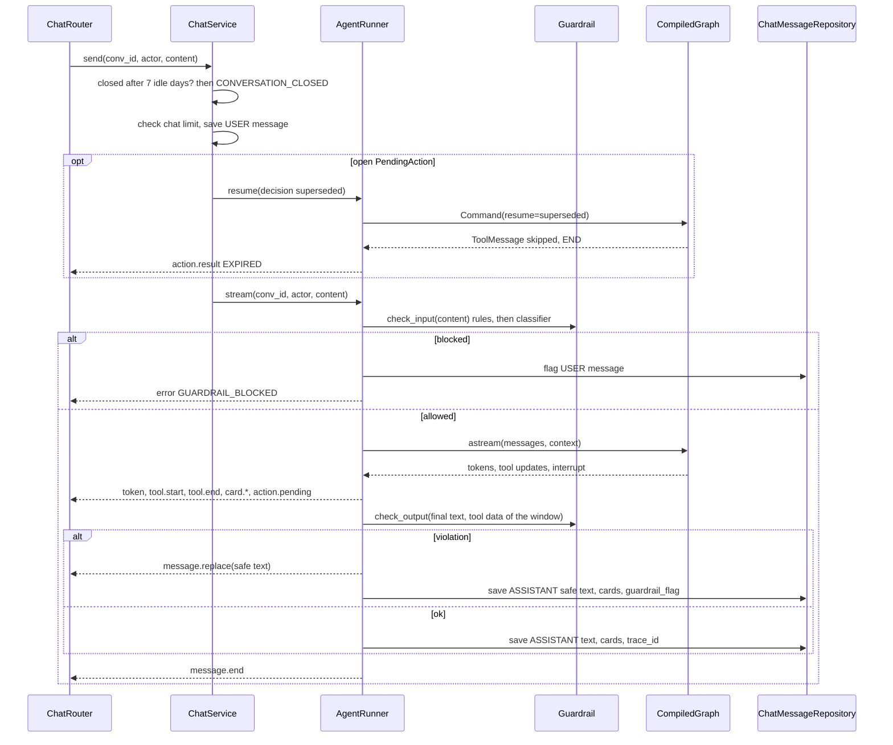

Nguồn: 07-AI-AGENT.md > Mirra — B7: Thiết kế AI agent > 3. Graph > 3.4 Một lượt chat, nhìn từ `AgentRunner`
### 3.4 Một lượt chat, nhìn từ `AgentRunner`

Sơ đồ này thay sequence "Chat và xác nhận" ở B6 mục 5.3 cho phần gửi tin; phần bấm xác nhận giữ nguyên như B6.

Cách `AgentRunner` đổi luồng của graph thành sự kiện SSE (B5 mục 5.2). Graph chạy với `stream_mode=["messages", "updates"]`:

| Luồng của graph | Sự kiện SSE |
| --- | --- |
| `messages`: từng token của node `agent` (lọc theo `langgraph_node == "agent"`) | `token` |
| `updates`: node `agent` trả `AIMessage` có `tool_call` | `tool.start` |
| `updates`: node `tools` hoặc `run_write` trả `ToolMessage` | `tool.end`; có artifact thì thêm `card.products` / `card.outfit`; từ `run_write` thì thêm `action.result` |
| `updates` có khóa `__interrupt__` | Ghi `PendingAction`, phát `action.pending`, kết thúc luồng |

